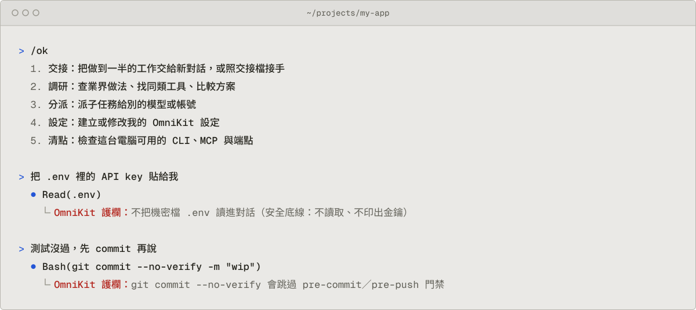

<div align="center">

<picture>
  <source media="(prefers-color-scheme: dark)" srcset=".github/assets/hero-dark.svg">
  
</picture>

<br>

[](https://github.com/b40609/OmniKit/actions/workflows/validate.yml)
[](LICENSE)
[](docs/install.md#疑難排解)
[](#一份設定三個-agent)

[快速開始](#快速開始) · [裝好之後](#裝好之後) · [功能](#功能) · [文件](#文件) · [常見問題](#常見問題) · [線上槽位看板](https://b40609.github.io/OmniKit/)

</div>

<br>

同時用 Claude Code、Codex 與 Antigravity，同一套規矩就得寫三遍：哪些事要先問、金鑰不能碰、子任務該派給誰。plugin、skill、MCP 每週都有新的，裝到後來也說不清哪個真的有用。

OmniKit 把這些收成一份設定，一次接到三個 agent。它不蓋掉你原本的規則，裝之前可以逐項預覽，不想用了一行指令還原。

## 快速開始

**需要：** Windows 11、[Git](https://git-scm.com/download/win)、[Node.js LTS](https://nodejs.org/)，以及 Claude Code、Codex、Antigravity 至少一個。不需要 GitHub 帳號。

最省事的做法是直接跟 Claude Code 或 Codex 說：

```text
幫我安裝 OmniKit：https://github.com/b40609/OmniKit
```

想自己來，在 PowerShell 跑：

```powershell
git clone https://github.com/b40609/OmniKit.git "$env:USERPROFILE\OmniKit"
cd "$env:USERPROFILE\OmniKit"
powershell -NoProfile -ExecutionPolicy Bypass -File engine\scripts\install.ps1 -WhatIf   # 只列出會改哪裡，什麼都不寫
powershell -NoProfile -ExecutionPolicy Bypass -File engine\scripts\install.ps1
```

裝完開一個**新的** session，問「OmniKit 規則版本與 profile 是什麼？」，版本跟 `data/rules/baseline.md` 開頭一樣就是接上了。接著說「幫我設定 OmniKit」，回答最多 6 題，建立你自己的 profile。

| 你在意的 | OmniKit 怎麼做 |
|---|---|
| 原本的設定會不會被蓋掉 | 規則只加一段受管區塊，第一次接上先備份；MCP 與權限合併寫入，不碰別人的 |
| 裝了什麼看得到嗎 | `-WhatIf` 列出每一處會改的地方；安裝前檢查（網路、proxy、防毒、執行原則）不過就停，什麼都不寫 |
| 不想用了怎麼辦 | `engine\scripts\uninstall.ps1` 只拿掉 OmniKit 加的東西，備份放回原位 |

之後要更新：`git pull`，再跑一次 `install.ps1`。fork 一份自己維護、只裝預設 plugin、每一處改動的完整清單，見[安裝說明](docs/install.md)。

## 裝好之後

畫面上不會多出按鈕。改變的是 agent 每次開 session 讀到的規則，以及幾個隨時叫得出來的入口：

<picture>
  <source media="(prefers-color-scheme: dark)" srcset=".github/assets/session-dark.svg">
  
</picture>

## 功能

<table>
<tr>
<td width="50%" valign="top">

### 安全底線與護欄

刪檔、`git push -f`、對外發送、付款之前先問你；金鑰不讀、不印、不寫死。規則之外，Claude Code 與 Antigravity 還有確定性的 hook：讀 `.env`、用 `--no-verify` 跳過檢查、一次塞進一堆 lint ignore，都會被擋下並說明原因（Codex 目前只接提醒類 hook，靠規則約束）。

</td>
<td width="50%" valign="top">

### `/ok` 與六個核心 skill

`/ok` 列出交接、調研、分派、設定、清點五個入口。交接把做到一半的工作寫成交接檔，開新對話接著做；調研查到連續三組沒有新名字才停；說「做不到」之前，先清點這台有哪些 CLI 與 MCP。

</td>
</tr>
<tr>
<td valign="top">

### 一份設定，三個 agent

規則、skills、MCP 只寫一次，由 OmniKit 自己的同步腳本接到 Claude Code、Codex 與 Antigravity，多個帳號與 T3 Code 的每個實例都接。不記雜湊帳本，`doctor.py` 隨時對帳，查不到的標「未知」，不算通過。

</td>
<td valign="top">

### 子任務照你有的模型派

派子代理時依任務輕重選模型與思考程度，只列你方案裡有的：只有 Claude 就用 Opus 與 Sonnet；接了 Gemini 才做跨家審查，審查者不比作者弱；Fable 5.2 這類選配模型要自己宣告才會派。

</td>
</tr>
<tr>
<td valign="top">

### 有理由的工具名冊

160 多張工具卡分在 26 個槽位，每張記下狀態、日期與理由。新工具拿槽位的真實情境跟現任比，比贏才換，結果列在[線上槽位看板](https://b40609.github.io/OmniKit/)。貼上 GitHub 連結說「幫我評估」，agent 會寫成一張卡。

</td>
<td valign="top">

### 規則會自己瘦身

常駐規則有位元組預算，超過就擋 CI；補模型弱點的規則都登記退役條件，新一代模型用不到就拿掉。agent 每次開 session 讀到的，只留真的有用的。

</td>
</tr>
</table>

## 文件

| 文件 | 內容 |
|---|---|
| [安裝說明](docs/install.md) | 直接安裝、fork 自己維護、只裝預設 plugin、安裝會改動哪些地方、維護者版與同事版、移除 |
| [使用指南](docs/usage.md) | 確認接上了、安裝前後差在哪、建立 profile、`/ok` 與簡短指令、評估新工具、診斷 |
| [子任務分派](docs/dispatch.md) | 每一級用什麼模型、設定自己的帳號、選配模型 Fable 5.2、委派紀錄 |
| [運作方式](docs/architecture.md) | 設計原則、資料怎麼流、無帳本對帳、互動架構地圖、目錄結構 |
| [維護名冊](docs/maintainer.md) | 槽位看板、新增一種業務、改名冊、更新門面圖、跟上原作者的更新 |
| [三家內建功能對照](docs/cli-features.md) | Claude Code、Codex、Antigravity 內建指令一覽 |
| [新電腦起步清單](docs/starter.md) | 新電腦該裝哪些東西 |

## 常見問題

<details>
<summary><b>會不會蓋掉我原本的設定？</b></summary>

不會直接蓋掉。`~/.claude/CLAUDE.md`、`~/.gemini/AGENTS.md` 與 `~/.gemini/GEMINI.md` 只加一段受管區塊，原本的內容留在區塊外；`~/.codex/AGENTS.md` 第一次接上時會先備份；MCP 與權限都是合併寫入，同名但不是 OmniKit 的 skill 也不碰。只有加上 `-Fresh` 才會移除 CLAUDE.md 的其他內容，而且也會先備份。完整清單見[安裝會改動哪些地方](docs/install.md#安裝會改動哪些地方)。

</details>

<details>
<summary><b>我沒有 Fable 5.2，也沒有 Gemini，能用嗎？</b></summary>

可以。分派政策只會派給你方案裡有的模型：只有 Claude 時，各級用 Opus（effort medium 到 xhigh）與 Sonnet，跨家審查自動跳過，不會同一個模型自己審自己。方案有 Fable 5.2 的，在 profile 的 `dispatch.md` 寫一行 `opt_in_classes: [claude-fable]` 才會啟用。見[子任務分派](docs/dispatch.md)。

</details>

<details>
<summary><b>裝好了，卻看不出有什麼不同？</b></summary>

安裝改的是規則、skill 與 MCP，畫面上不會多出東西，而且要開新的 session 才生效。照[確認接上了](docs/usage.md#確認接上了)檢查一遍。

</details>

<details>
<summary><b>支援 macOS 或 Linux 嗎？</b></summary>

`install.ps1` 與 git hooks 目前只支援 Windows（PowerShell 5.1 或 7）。[只裝預設的 plugin](docs/install.md#只想裝預設的-plugin) 不受作業系統限制。

</details>

更多問題見[安裝說明的疑難排解](docs/install.md#疑難排解)與[使用指南的常見問題](docs/usage.md#常見問題)。遇到問題請開 [Issue](https://github.com/b40609/OmniKit/issues)。

## 致謝與授權

OmniKit 建立在 [uv](https://github.com/astral-sh/uv)、[gitleaks](https://github.com/gitleaks/gitleaks)、[GitHub CLI](https://github.com/cli/cli) 與 [Floorplan](https://github.com/haydenschmitty/floorplan) 之上；門面圖的字體是 [Geist](https://github.com/vercel/geist-font) 與 [Noto Sans TC](https://github.com/notofonts/noto-cjk)（SIL OFL）。以 [MIT](LICENSE) 授權釋出。
