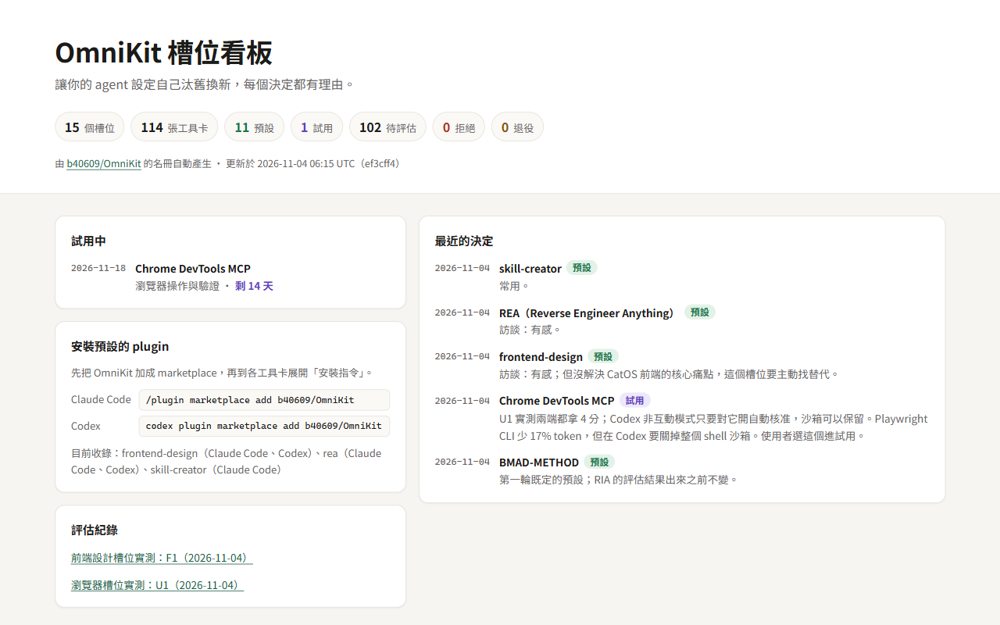
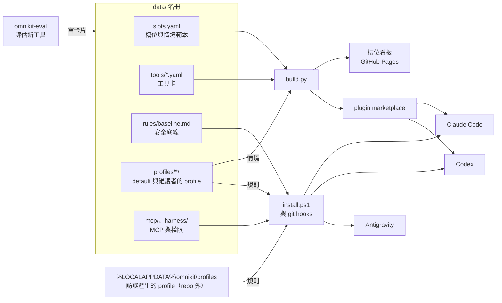
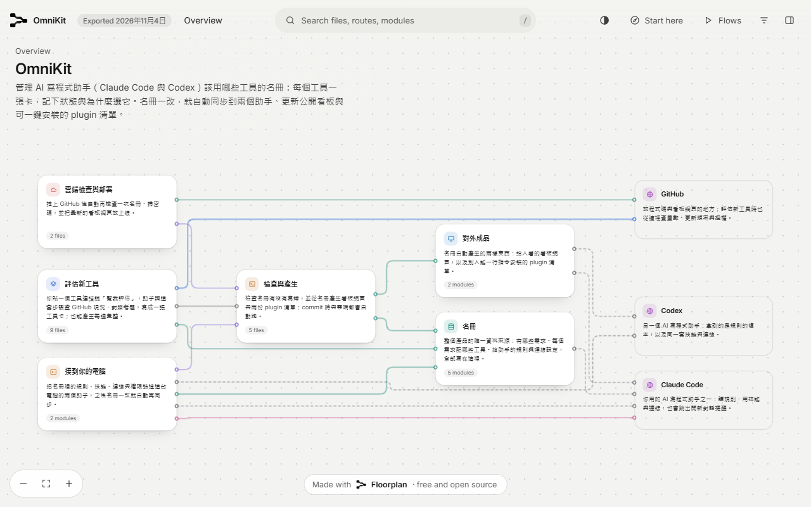

<div align="center">

# OmniKit

**讓你的 agent 設定自己汰舊換新，每個決定都有理由。**

[](https://github.com/b40609/OmniKit/actions/workflows/validate.yml)
[](https://b40609.github.io/OmniKit/)
[](LICENSE)
[](#常見問題)

[槽位看板](https://b40609.github.io/OmniKit/) · [架構地圖](https://b40609.github.io/OmniKit/map.html) · [快速開始](#快速開始) · [裝好之後](#裝好之後) · [運作方式](#運作方式) · [常見問題](#常見問題)

</div>

<picture>
  <source media="(prefers-color-scheme: dark)" srcset=".github/assets/board-dark.png">
  
</picture>

Claude Code、Codex 與 Antigravity 的 plugin、skill、MCP 每週都有新的，裝了一堆之後，很難說清楚哪個真的有用、當初為什麼選它。

OmniKit 把「該用哪個」變成一份有紀錄的名冊。每一種需求是一個**槽位**，配上幾個真實的工作情境；每個工具一張**卡片**，記下狀態、日期與理由。新工具進來時，拿槽位的情境跟現任比，比贏了才換，換的理由也會留下來。

## 特色

- **每個決定都有理由**：卡片記下狀態（預設、試用、待評估、拒絕、退役）、決定日期與理由，過了半年還查得到當初為什麼選它。
- **用真實情境比，不看星數**：每個槽位配幾個你實際會遇到的情境，評估新工具就拿這些當考題。
- **一份設定，三個 agent**：規則、skills、MCP 只寫一次，接到 Claude Code、Codex 與 Antigravity；全由 OmniKit 自己的腳本接，不依賴第三方同步工具。
- **名冊是唯一來源**：看板與兩份 plugin marketplace 都由名冊產生，CI 會檢查它們跟名冊一致。
- **評估分層、有額度**：第 0 層免費、第 1 層便宜、第 2 層實測；每週的實測次數有上限，不會一直燒 token。
- **安全的預設**：工具固定版本並比對 SHA256、commit 前用 gitleaks 掃金鑰、安裝第三方 skill 前先掃描、權限規則只增不刪。

## 快速開始

### 直接安裝（同事用，不用 fork、不用 GitHub 帳號）

**需要：** Windows 11、[Git](https://git-scm.com/download/win)、[Node.js LTS](https://nodejs.org/)（MCP 用）、Claude Code、Codex、Antigravity 至少一個（裝了的都會接上）。不需要 GitHub 帳號，也不用開 Actions 或 Pages。

可以直接在 Claude Code 或 Codex 說「幫我安裝 OmniKit：https://github.com/b40609/OmniKit」，agent 會照下面的步驟做；也可以自己在 PowerShell 跑。

1. **Clone。** 放在之後不會搬動的地方：規則與 skills 會連到這個資料夾。

   ```powershell
   git clone https://github.com/b40609/OmniKit.git "$env:USERPROFILE\OmniKit"
   cd "$env:USERPROFILE\OmniKit"
   ```

2. **安裝。** 先加 `-WhatIf` 預覽，什麼都不會改；確認之後拿掉 `-WhatIf` 再跑一次。開始前會先做安裝前檢查（git、連得到 GitHub、npm、PyPI、proxy、防毒、PowerShell 執行原則），任一項不通過就停下來、列出處理方式，什麼都不寫入。完整清單見[安裝會改動哪些地方](#安裝會改動哪些地方)。

   ```powershell
   powershell -NoProfile -ExecutionPolicy Bypass -File engine\scripts\install.ps1 -WhatIf
   powershell -NoProfile -ExecutionPolicy Bypass -File engine\scripts\install.ps1
   ```

   這樣裝的是同事版：不設 git hook，`git pull` 不會改任何設定；讓 agent 免問就能用某個工具之前，會先問你。見[維護者版與同事版](#維護者版與同事版)。

3. **確認接上了。** 開一個新的 Claude Code 或 Codex session，問「OmniKit 規則版本與 profile 是什麼？」，版本跟 `data/rules/baseline.md` 開頭的一樣，就表示規則生效了。skill 與 MCP 怎麼檢查，見[裝好之後](#裝好之後)。

4. **建立自己的 profile。** 在新的 session 說「幫我設定 OmniKit」，回答最多 6 題，看過預覽才寫入，見[建立自己的 profile](#建立自己的-profile)。profile 存在 `%LOCALAPPDATA%\omnikit\profiles\<名稱>\`，不在 repo 裡，不會被 commit 或上傳。

之後要更新：`git pull`，再跑 `install.ps1 -WhatIf` 預覽、`install.ps1` 套用。`git pull` 本身不會改任何設定。

### Fork 一份自己維護（維護者用）

想換成自己的名冊、看板與 marketplace，就 fork 一份。fork 會帶著原作者已經整理好的 100 多張工具卡，可以直接當起點。另外需要 GitHub 帳號。

1. **Fork 並開啟看板。** 按本頁右上角的 **Fork**，接著在你的 fork 上：
   - **Actions** 分頁：fork 的 workflow 預設是關的，按 **I understand my workflows, go ahead and enable them**。
   - **Settings → Pages**：**Source** 選 **GitHub Actions**。

2. **Clone 你的 fork。**

   ```powershell
   git clone https://github.com/<你的帳號>/OmniKit.git
   cd OmniKit
   ```

3. **認識 profile。** agent 讀到的規則分兩層：
   - `data/rules/baseline.md` 是安全底線，所有人都套用：刪除、對外發送、付款、push 前先確認，不碰金鑰。
   - profile 是個人層：`AGENTS.md` 寫語言、語氣、哪些事可以直接做；`scenarios.yaml` 寫評估工具用的真實情境，沒寫的槽位用 `data/slots.yaml` 的範本。訪談產生的 profile 存在 repo 外的 `%LOCALAPPDATA%\omnikit\profiles\<名稱>\`；repo 裡的 `data/profiles/<名稱>/` 放 `default` 與維護者手寫、要跟著 repo 的 profile。兩邊同名時，repo 外的優先。

   不用先改檔案：先用 `default` 安裝（繁體中文、下載安裝前先問），裝好之後用[訪談](#建立自己的-profile)產生你自己的 profile。想手寫也行：複製 `data/profiles/default` 成 `data/profiles/<你的名字>` 再改，會跟著你的 fork commit；`data/profiles/ryan` 是原作者的，可以參考。

4. **安裝。** 加上 `-Edition maintainer`（指定一次就會記住）：commit 前驗證名冊、掃金鑰，commit 或 pull 後自動同步。已經有自己的 profile，就加上 `-ProfileName <名稱>`，一樣指定一次就會記住。

   ```powershell
   powershell -NoProfile -ExecutionPolicy Bypass -File engine\scripts\install.ps1 -Edition maintainer -WhatIf
   powershell -NoProfile -ExecutionPolicy Bypass -File engine\scripts\install.ps1 -Edition maintainer
   ```

   偵測到這是 fork 時，會自動把 `data/omnikit.yaml` 的 `repo`、`owner`、`marketplace` 改成你的、看板用的 `profile` 改回 `default`，並重新產生 marketplace 清單，避免跟原作者的撞名。

5. **推上去。** 推到 main 之後，GitHub Actions 會部署看板到 `https://<你的帳號>.github.io/OmniKit/`。

   ```powershell
   git commit -am "chore: 改成自己的 OmniKit"
   git push
   ```

6. **確認接上了，再建立自己的 profile。** 跟上面直接安裝的第 3、4 步一樣。

### 只想裝預設的 plugin

不用 fork，也不會動到你的其他設定。先把 OmniKit 加成 marketplace：

| | 指令 |
|---|---|
| Claude Code | `/plugin marketplace add b40609/OmniKit` |
| Codex | `codex plugin marketplace add b40609/OmniKit` |

再裝想要的 plugin，例如 frontend-design：

| | 指令 |
|---|---|
| Claude Code | `/plugin install frontend-design@omnikit-b40609` |
| Codex | `codex plugin add frontend-design@omnikit-b40609` |

目前收錄哪些，看[槽位看板](https://b40609.github.io/OmniKit/)的「安裝預設的 plugin」。

## 裝好之後

安裝不會在 Claude Code、Codex 或 Antigravity 的畫面上多出按鈕或面板。改變的是 agent 開 session 時讀到的規則，以及多了三個 skill（訪談選了不評估新工具的是兩個）、一個 MCP。**已經開著的 session 不會重讀，要開新的 session 才生效。**

### 確認接上了

| 檢查 | Claude Code | Codex | Antigravity |
|---|---|---|---|
| 規則 | 問「OmniKit 規則版本與 profile 是什麼？」，版本跟 `data/rules/baseline.md` 開頭的「規則版本」一樣，profile 是你選的 | 同左 | 同左 |
| skill | 輸入 `/omnikit`，選單裡會出現 `omnikit-setup`、`omnikit-weekly` 與 `omnikit-eval`（訪談選了不評估新工具的，沒有 `omnikit-eval`） | 輸入 `$omnikit`，或用 `/skills` 列出來 | 問「你可用的 skill 有哪些？」，會列出這幾個 |
| MCP | 終端機跑 `claude mcp get chrome_devtools`，狀態是 Connected | 終端機跑 `codex mcp list`，`chrome_devtools` 是 enabled | 終端機跑 `agy mcp list`，`chrome_devtools` 是 enabled |

終端機跑 `uv run engine/scripts/agents.py status`，可以看到這台接上了哪些 agent、OmniKit 管了哪些 skills 與 MCP。

逐項檢查跑 `uv run engine/scripts/doctor.py`：規則區塊、skills、MCP、權限規則與提醒 hook 都還在、跟寫入時一樣，再用各 agent 自己的清單確認 MCP 已啟用；查不到的標「未知」，不算通過。加 `--preflight` 一併跑安裝前檢查。

### 安裝前後差在哪

| 項目 | 會有什麼不同 | 三個 agent 的差別 |
|---|---|---|
| 規則（`data/rules/baseline.md` + profile 的 `AGENTS.md`） | 安全底線所有人都一樣；回覆用什麼語言、寫多詳細、哪些事可以直接做，照你選的 profile。`default` 是繁體中文、下載安裝前先問 | Claude Code 直接讀這兩份，改完開新 session 就生效。Codex 與 Antigravity 讀的是兩份接在一起的內容：改了 profile 要跑 `uv run engine/scripts/profiles.py` 重新接上（維護者版改的是 repo 裡的檔案的話，commit 時 git hook 會自動同步） |
| `omnikit-setup` skill | 說「幫我設定 OmniKit」，agent 先掃描這台的環境，再問最多 6 題，產生你自己的 profile 並接上。見[建立自己的 profile](#建立自己的-profile) | 三邊說「幫我設定 OmniKit」都會觸發；要手動叫，Claude Code 輸入 `/omnikit-setup`，Codex 輸入 `$omnikit-setup` |
| `omnikit-weekly` skill | 說「OmniKit 本週週報」，列出你的個人週報：沒在用的工具、上游有新版的工具、有更好的選擇、被手動改過的設定、主動建議的接受率；還查不到的標「未知」。不連網，見[個人週報](#個人週報) | 三邊說「OmniKit 本週週報」都會觸發；要手動叫，Claude Code 輸入 `/omnikit-weekly`，Codex 輸入 `$omnikit-weekly`。訪談怎麼答都會裝 |
| `omnikit-eval` skill | 貼 GitHub 連結說「幫我評估」，agent 會查 GitHub 現況、對照槽位情境，寫成 `data/tools/` 裡的工具卡；「每週彙整」是維護者評估工具用的 | 三邊說「幫我評估」都會觸發；要手動叫，Claude Code 輸入 `/omnikit-eval`，Codex 輸入 `$omnikit-eval`。Codex 與 Antigravity 用的是複製品，skill 改完要 commit 才會更新 |
| `chrome_devtools` MCP | agent 能自己開瀏覽器：開網頁、截圖、看 console 與網路請求。每次用暫時的瀏覽器設定檔，碰不到你的登入狀態 | Claude Code 已加進免問清單，Codex 設成自動核准，兩邊都不會跳權限確認；Antigravity 照它自己的權限設定 |
| 開新對話提醒 | 每回合結束時檢查一次：上下文每跨過 100k tokens、或這一回合成功 `git push`，就跳一行提醒你考慮開新對話。只提醒，不會自己換對話 | Claude Code 裝好就生效。Codex 多看一項：對話累計第 1、3、9、27… 次自動壓縮時也提醒（Codex 常在 100k 前就壓縮）；新 hook 要先信任才會跑，CLI 輸入 `/hooks`、桌面版到設定的 Hooks 按信任；OmniKit 搬位置或原本那支 uv 不在了，指令會改，要再信任一次 |
| git hooks（只有維護者版） | 只作用在 OmniKit repo：commit 前掃金鑰、驗證名冊；commit 或 pull 動到規則、profile、MCP、權限時自動同步。同事版不設 | 跟 agent 無關 |

開新的 session 試試看：

```text
OmniKit 規則版本與 profile 是什麼？
幫我設定 OmniKit
幫我評估 https://github.com/<owner>/<repo>
用瀏覽器打開 http://localhost:3000，看 console 有沒有錯誤
OmniKit 本週週報
```

個人週報、評估、改名冊、跟上原作者的更新，見[日常使用](#日常使用)。

### 建立自己的 profile

在新的 session 說「幫我設定 OmniKit」。`omnikit-setup` 會：

1. **掃描**：列出這台裝了哪些 agent、目前的規則、skills 與 MCP（只看名稱與版本，不讀金鑰）。
2. **訪談**：最多 6 題，大多是選擇題：主要用途、最想改善的習慣、回覆的語言與詳略、agent 可以自己做到哪、要不要評估新工具、主要專案。
3. **預覽**：先給你看產生的規則，同意才寫入。
4. **建立並套用**：寫進 repo 外的 `%LOCALAPPDATA%\omnikit\profiles\<名稱>\`，接上這台接好的 agent，開新 session 生效。

| 你選的 | 規則裡寫成 |
|---|---|
| agent 可以自己做到哪 | 每步先問：改檔案、執行指令前先列計畫等你同意。專案內直接做（建議）：下載安裝、改專案以外的才先問。大多放手：下載安裝也直接做 |
| 最想改善的習慣 | 例如「常改太多」變成「只改需求相關的地方，其他想改的先列出來問你」 |
| 要評估新工具 | 情境範本裡的 `<你的專案>` 換成你的專案，評估工具時拿來當考題 |
| 不評估新工具 | 不裝 `omnikit-eval`（評估工具與維護者的每週彙整都在這個 skill 裡）；已經裝了的會拿掉。個人週報（`omnikit-weekly`）照樣有。之後改主意，重新訪談選「要」就會裝回來 |

規則檔與情境檔都由 `engine/scripts/profile_new.py` 依固定範本產生、驗證，agent 只負責問問題；寫入後可以直接改，改完跑 `uv run engine/scripts/profiles.py` 重新接上。重新訪談時會帶入上次的答案，舊檔先備份成 `.bak`；手寫的 profile 與 repo 裡已經有的名稱不會被覆蓋。安全底線不能從 profile 放寬。

profile 存在 repo 外的 `%LOCALAPPDATA%\omnikit\profiles\<名稱>\`（`AGENTS.md`、`scenarios.yaml`，以及下次訪談預填用的 `answers.json`），不會被 commit、push 或上傳，在 repo 裡跑 `git status` 也看不到。舊版存在 repo 裡（`data/profiles/<名稱>/`）的，重跑 `install.ps1` 或說「幫我設定 OmniKit」時會問你要不要搬過去；搬好、確認內容一樣才刪 repo 裡的舊檔，不同意就不動。

### 預設 plugin 要另外裝

`install.ps1` 不會把 OmniKit 加成 marketplace，也不會安裝看板上的預設 plugin。想用的話，照[只想裝預設的 plugin](#只想裝預設的-plugin) 的指令裝。用自己的 fork 時：

- 把指令裡的 `b40609/OmniKit` 換成你的 fork。
- `@` 後面的 marketplace 名稱換成你 `data/omnikit.yaml` 的 `marketplace`，例如 `omnikit-<你的帳號小寫>`。
- 先 push 到 GitHub，marketplace 才讀得到最新的清單。

## 運作方式



1. **評估**：把工具的 GitHub 連結貼給 agent，`omnikit-eval` 會查 GitHub 現況、對照槽位情境，寫成一張工具卡。
2. **產生**：commit 時 git hook 驗證名冊並重新產生 marketplace 清單；推到 main 之後，GitHub Actions 重建看板。
3. **同步**：`install.ps1` 把規則（安全底線 + 你選的 profile）、skills、MCP 接到 Claude Code、Codex 與 Antigravity（`engine/scripts/agents.py`），權限與提醒 hook 接到 Claude Code 與 Codex。維護者版之後 commit 或 pull 動到這些檔案時，git hook 會自動再同步；同事版不設 git hook，pull 不會改任何設定。

想看每個部分、每個檔案在做什麼，打開[互動架構地圖](https://b40609.github.io/OmniKit/map.html)：每個檔案都有白話說明，另有 3 條逐步導覽（評估新工具、改規則、第一次安裝）。建議用電腦開。

<a href="https://b40609.github.io/OmniKit/map.html">
<picture>
  <source media="(prefers-color-scheme: dark)" srcset=".github/assets/map-dark.png">
  
</picture>
</a>

## 安裝會改動哪些地方

| 位置 | 做什麼 |
|---|---|
| `%LOCALAPPDATA%\Programs\` | 安裝固定版本的 uv、gh，以及維護者版才裝的 gitleaks；比對 SHA256，不改 PATH。這台已經有 uv、gh 就沿用 |
| `data/omnikit.yaml` | fork 出來的 repo，改成你的 `repo`、`owner`、`marketplace`，`profile` 改回 `default`，並重新產生 marketplace 清單 |
| `~/.claude/CLAUDE.md` | 在開頭加一段受管區塊，import `data/rules/baseline.md` 與你選的 profile 的 `AGENTS.md`（訪談產生的在 `%LOCALAPPDATA%\omnikit\profiles`，其他在 `data/profiles`）；路徑有空白時用 `\ ` 跳脫，不然 Claude Code 讀到空白就斷掉。其他內容不動 |
| `~/.codex/AGENTS.md` | 在開頭加一段受管區塊，放底線與 profile 接在一起的內容；原本的規則留在區塊外，照常生效，也先備份成 `AGENTS.md.pre-omnikit`。舊版整份換掉的，同步時換成只有區塊（規則內容一樣）；區塊被拿掉的話，同步時不加回去 |
| `~/.gemini/GEMINI.md` | Antigravity 的規則：在開頭加一段受管區塊，放底線與 profile 接在一起的內容；原本的先備份成 `GEMINI.md.pre-omnikit`。原地改寫，這個檔案跟其他工具共用（硬連結）時，其他名字會一起更新，連結不會斷 |
| `~/.claude/skills` | `engine/skills` 的每個 skill 用資料夾連結接上，改完馬上生效 |
| `~/.agents/skills` | Codex 與 Antigravity 共用：`engine/skills` 的每個 skill 複製一份（Antigravity 不跟隨資料夾連結），裡面的 `.omnikit.json` 記來源；同名但不是 OmniKit 的不碰 |
| `~/.claude.json`、`~/.codex/config.toml`、`~/.gemini/config/mcp_config.json` | 寫入 `data/mcp/servers.yaml` 的 MCP server，只動這些 server 裡 OmniKit 管的欄位；你加的欄位（例如停用）與 Codex 的工具核准紀錄都留著。被你改過、被你移除，或同名但不是 OmniKit 的，先停下來問，見 [MCP 有衝突時](#mcp-有衝突時)。Claude 用 `claude mcp add-json`；Codex 寫入前驗證其他設定沒被動到；Antigravity 不寫 BOM（它讀到 BOM 會整份失敗）。`config.toml` 結尾另加一段 `[[hooks.Stop]]` 開新對話提醒 |
| `%LOCALAPPDATA%\omnikit\` | `profiles\<名稱>\` 是訪談產生的 profile（個人資料，不在 repo 裡；移除時也不刪）；`profile.json` 記這台選的 profile；`edition.json` 記這台是維護者版還是同事版；`consent.json` 記你同意了哪些工具免問；`agents.json` 記接上了哪些 agent、OmniKit 管了哪些 skills，以及每個 MCP server 寫入時的雜湊（判斷有沒有被改過）；`rules\AGENTS.md` 是底線與 profile 接在一起的內容（移除時比對用） |
| 舊版的 skillshare | 以前用 skillshare 接的電腦，重跑 `install.ps1` 會改由 OmniKit 接手，並拿掉 skillshare 設定裡 OmniKit 的部分；skillshare 本身不刪 |
| npm 全域套件 | 安裝 `data/mcp/packages.txt` 指定的固定版本 |
| `~/.claude/settings.json` | 把 `data/harness/claude-allow.txt` 的規則補進 `permissions.allow`，只增不刪；同事版只補你同意過的工具。在 `hooks.Stop` 加上開新對話提醒（`engine/scripts/session_nudge.py`） |
| 這個 repo | 維護者版：`core.hooksPath` 指到 `.githooks`，commit 前掃金鑰、驗證名冊；commit 或 pull 動到規則、profile、skills、MCP、權限、提醒 hook 時自動同步。同事版不設 git hook |
| `%LOCALAPPDATA%\omnikit\install-record.json` | 安裝紀錄：記下這台原本沒有、由 OmniKit 裝上的工具、npm 套件與權限規則，移除時只動這些 |

加上 `-Fresh` 會把 `~/.claude/CLAUDE.md` 受管區塊以外的舊規則移除（先備份成 `CLAUDE.md.pre-omnikit`），適合想讓 OmniKit 的規則完全取代舊規則的人。

### 維護者版與同事版

兩版的規則、skills、MCP 接法都一樣，只差下面三件事。用 `install.ps1 -Edition maintainer` 或 `-Edition colleague` 指定，指定一次就會記住；沒指定過的話，分版之前就裝過的電腦是維護者版，其他都是同事版。

| | 維護者版 | 同事版（預設） |
|---|---|---|
| git hook | commit 前掃金鑰、驗證名冊；commit 或 pull 後自動同步。在 git worktree（例如 `.claude/worktrees/` 底下）裡只掃金鑰、驗證名冊，不同步，合進 main 後由主 checkout 同步 | 不設。pull 不會改任何設定；要套用更新，先跑 `install.ps1 -WhatIf` 預覽，再跑 `install.ps1` |
| 免問核准 | 照 `data/harness/claude-allow.txt` 與 `data/mcp/servers.yaml` 寫入，那是維護者自己同意的 | 每個工具先問你，同意了才寫入（預設否）。之後可以改：`uv run engine/scripts/agents.py approvals` 查看，`--grant <名稱>` 同意、`--revoke <名稱>` 撤回 |
| gitleaks | 裝，給 pre-commit 用 | 不裝 |

看這台是哪一版：`uv run engine/scripts/edition.py`。

## 移除

```powershell
powershell -NoProfile -ExecutionPolicy Bypass -File engine\scripts\uninstall.ps1
```

會先列出要做的事，確認後才動手：

- 三個 agent 的規則、skills、MCP，以及權限、git hook 還原成安裝前的樣子，安裝前的備份會放回原位；只拿掉 OmniKit 的，其他的不碰。
- 只移除安裝紀錄裡、由 OmniKit 裝上的工具與 npm 套件；安裝前就有的都保留。
- 加 `-KeepTools` 只還原設定、保留工具；加 `-Yes` 不詢問直接移除。
- repo 資料夾與訪談產生的 profile（`%LOCALAPPDATA%\omnikit\profiles`）不會刪，重新安裝就能接著用；不需要的話自己刪掉即可。

## 日常使用

### 換 profile

```powershell
uv run engine/scripts/profiles.py --show          # 這台現在用哪個
uv run engine/scripts/profiles.py --set <名稱>    # 換成這個 profile，接上的 agent 一起換
uv run engine/scripts/profiles.py --migrate       # 舊版存在 repo 裡的 profile 搬到 repo 外（先問你）
```

找 profile 時先找 repo 外的 `%LOCALAPPDATA%\omnikit\profiles\<名稱>`，再找 repo 裡的 `data/profiles/<名稱>`。換完開新的 session 才生效。skills 也會跟著同步：換到訪談選了不評估新工具的 profile，`omnikit-eval` 會拿掉，換回來再裝上。還沒選過的電腦會一直用 `default`，並在安裝與同步時提醒。想重新訪談、改掉原本的答案，說「幫我設定 OmniKit」就好。

### 個人週報

每週在 Claude Code、Codex 或 Antigravity 裡說一次「OmniKit 本週週報」（`omnikit-weekly`）。不管訪談時有沒有選評估新工具都有，依序列出：

1. **沒在用的工具**：這台 30 天沒用到的 skill 與 plugin，見下方[清掉沒在用的 skill](#清掉沒在用的-skill)。
2. **上游有新版的工具**：目前標「未知」，要等工具包 lock 與「檢查更新」。
3. **有更好的選擇**：目前標「未知」，要等工具卡的證據等級。
4. **設定被手動改過的項目**：規則區塊、skills、MCP、權限與提醒 hook 跟 OmniKit 寫入時不一樣的，跟 `doctor.py` 的寫入檢查一樣。
5. **主動建議的接受率**：目前標「未知」，主動建議還沒開始記錄。
6. **成本**：
   - 7 天內新裝的工具，每段對話多出多少 token。
   - 成本高又沒在用的：每段對話 1,000 tokens 以上，14 天內與最近 10 段對話都沒用到，不用等 30 天。
   - 背景與非互動的模型用量，例如記憶工具在背景整理對話。
   - 新對話第一回合的大小，比上週多 10% 以上會列出原因。
   - 裝著、但名冊上不是預設或試用的工具。

   開頭成本照對話紀錄裡第一回合實際載入的內容量（skill 清單、hook 加進 context 的內容、MCP 的說明），不採用工具自己報的數字。

只讀這台的紀錄與設定，不連網、不上傳；完整內容存在 `%LOCALAPPDATA%\omnikit\weekly\<年>-W<週>.md`，同一週重跑會換成最新的。也可以在 repo 根目錄跑 `uv run engine/scripts/weekly.py`。

### 評估新工具

在 Claude Code、Codex 或 Antigravity 裡直接說（訪談選了評估新工具才有；「每週彙整」是維護者看評估額度與評估漏斗用的）：

```text
幫我評估 https://github.com/<owner>/<repo>
這個跟現在用的比一下
每週彙整
```

| 層 | 成本 | 做什麼 |
|---|---|---|
| 0 | 免費 | GitHub 現況、名冊比對、硬性門檻、安全掃描 |
| 1 | 便宜 | 讀 README，對照槽位情境寫卡片，狀態是「待評估」 |
| 2 | 實測 | 拿槽位情境實際跑一遍並評分，點名才跑；紀錄放在 `data/evals/` |

### 清掉沒在用的 skill

個人週報的第一節（維護者每週彙整的最後一節也有），會列出這台電腦 30 天沒用到的 skill 與 plugin，建議移除；每週彙整另外點出名冊上還是預設或試用中的。

- **怎麼算用到**：讀 Claude Code、Codex、Antigravity 的本機對話紀錄，只算實際讀取或呼叫的。每段對話開頭列出的 skill 清單不算。只輸出名稱、對話數與日期，不輸出對話內容，也不上傳。
- **Codex 的 plugin**：以最近一次 Codex 對話實際載入的 skill 清單為準，已停用的 plugin 與 skill 不列；讀到 plugin 裡的 SKILL.md，算那個 plugin 用到。
- **不會誤判剛裝的**：裝不到 30 天的先不判斷。Claude Code 的 plugin 只要累計用過就不列。
- **重複安裝**：同一個 agent 讀得到兩份同名 skill、只有一份有在用時，會標成「可能是重複的」。
- **移除前會先問**：agent 只會列出來問你，不會自己刪。

想看完整清單或換天數：

```powershell
uv run engine/scripts/usage.py --days 60
```

### MCP 有衝突時

OmniKit 寫入 MCP server 之後，`agents.json` 會記下它管的欄位的雜湊。下次同步發現下面三種情況，就先停下來，規則、skills、MCP 都不寫，並列出不同的欄位名稱（不列值，值可能是金鑰）：

- 你在 agent 裡改過 OmniKit 管的欄位，例如 `args`。
- OmniKit 加過的 server 被你移除了。
- 已經有同名的 server，但不是 OmniKit 加的。

`install.ps1` 會逐一問你；不能互動的時候（例如 git hook），決定之後執行其中一個，再重跑剛才的指令：

```powershell
uv run engine/scripts/agents.py resolve <名稱> --use-omnikit   # 改用 data/mcp/servers.yaml 的設定
uv run engine/scripts/agents.py resolve <名稱> --keep-mine     # 保留你的設定，OmniKit 之後不再管它
```

選了 `--keep-mine` 之後想改回由 OmniKit 管，再執行一次 `--use-omnikit` 就好。

### 改名冊

改完 `data/` 直接 commit：維護者版的 pre-commit hook 會驗證名冊，並重新產生 marketplace 清單一起放進 commit。要手動檢查：

```powershell
uv run engine/scripts/validate.py
uv run engine/scripts/build.py --site _site
```

uv 不在 PATH 上的話，把 `uv` 換成 `& "$env:LOCALAPPDATA\Programs\uv\uv.exe"`。CI 會再檢查名冊、marketplace 清單是不是最新、看板能不能產生，並用 gitleaks 掃金鑰。

### 更新架構地圖

`engine/site/map.html` 是用 [Floorplan](https://github.com/haydenschmitty/floorplan) 在本機產生後匯出的，CI 不會重畫。`engine/` 有結構上的改動時，在裝了 Floorplan 的 Claude Code 裡說「更新 floorplan」，再匯出並 commit：

```powershell
node floorplan/serve.mjs --export engine/site/map.html
```

`floorplan/` 本身不進 git；換電腦後第一次要重畫整張地圖。

### 跟上原作者的更新

在你的 fork 頁面按 **Sync fork**，或在本機：

```powershell
git remote add upstream https://github.com/b40609/OmniKit.git   # 只要做一次
git pull upstream main
```

- `data/` 有衝突時，留你自己的版本。
- 兩份 marketplace 清單有衝突時，直接重新產生：`uv run engine/scripts/build.py --marketplace-only`。
- `engine/` 有更新時，重跑一次 `install.ps1`。

## 目錄結構

```text
data/                        資料：fork 後換成你的
  omnikit.yaml               看板與 marketplace 的公開設定
  slots.yaml                 槽位與情境範本
  tools/<id>.yaml            名冊，一個工具一張卡
  rules/baseline.md          安全底線，所有人都套用
  profiles/<名稱>/           跟著 repo 的 profile：個人規則（AGENTS.md）與真實情境（scenarios.yaml）；
                             default 是沒選時的預設。訪談產生的存在 repo 外（%LOCALAPPDATA%\omnikit\profiles）
  mcp/                       MCP server 定義與 npm 套件版本
  harness/                   Claude Code 免問的權限規則
  evals/                     實測紀錄
engine/                      引擎：不用改
  schema/                    名冊與槽位的 JSON Schema
  scripts/                   安裝、接上三個 agent、掃描、使用統計、個人週報、產生與選 profile、驗證、產生看板與 marketplace、開新對話提醒
  site/                      看板的樣式與程式，以及匯出的架構地圖（map.html）
  skills/omnikit-setup/      訪談建立個人 profile 的 skill
  skills/omnikit-weekly/     個人週報的 skill（每個人都有）
  skills/omnikit-eval/       評估新工具的 skill
.claude-plugin/              Claude Code 的 marketplace（由名冊產生，不要手改）
.agents/plugins/             Codex 的 marketplace（由名冊產生，不要手改）
```

## 常見問題

<details>
<summary><b>裝好了，卻看不出有什麼不同？</b></summary>

安裝改的是規則、skill 與 MCP，畫面上不會多出東西，而且要開新的 session 才生效。照[確認接上了](#確認接上了)檢查一遍。預設 plugin 不會自動安裝，見[預設 plugin 要另外裝](#預設-plugin-要另外裝)。

</details>

<details>
<summary><b>會不會蓋掉我原本的設定？</b></summary>

不會直接蓋掉。`~/.claude/CLAUDE.md` 與 `~/.gemini/GEMINI.md` 只加一段受管區塊；`~/.codex/AGENTS.md` 第一次接上時會先備份；MCP 與權限都是合併寫入，同名但不是 OmniKit 的 skill 也不碰。只有加上 `-Fresh` 才會移除 CLAUDE.md 的其他內容，而且也會先備份。完整清單見[安裝會改動哪些地方](#安裝會改動哪些地方)，不想用了隨時可以[移除](#移除)。

</details>

<details>
<summary><b>支援 macOS 或 Linux 嗎？</b></summary>

`install.ps1` 與 git hooks 目前只支援 Windows（PowerShell 5.1 或 7）。[只裝預設的 plugin](#只想裝預設的-plugin) 不受作業系統限制。

</details>

<details>
<summary><b>不想用某個預設工具怎麼辦？</b></summary>

把那張卡（`data/tools/<id>.yaml`）的 `status` 改掉並 commit，marketplace 與看板會跟著更新。已經裝好的 plugin 要自己移除。

</details>

<details>
<summary><b>為什麼不用 skillshare 了？</b></summary>

以前規則、skills 與 MCP 是靠 [skillshare](https://github.com/runkids/skillshare) 同步。公司電腦的防毒（例如 Trend Micro 的「新出現的程式」偵測）會擋下從網路下載、很少人用或剛發布的程式：執行前跳通知要你按允許，要剛好盯著畫面才按得到，錯過就擋下。git hook 與 agent 在背景同步時常沒人看畫面，同步就失敗，放行之後也可能又被擋。

OmniKit 只支援 Claude Code、Codex 與 Antigravity 三個 agent，所以改由自己的 Python 腳本（`engine/scripts/agents.py`）直接接，用的是 uv 與 Python，不再需要另外放行。以前用 skillshare 接的電腦，重跑一次 `install.ps1` 就會改由 OmniKit 接手；skillshare 本身留著，不需要的話可以自己移除。

</details>

<details>
<summary><b>Antigravity 看不到 OmniKit 的 skill？</b></summary>

Antigravity 不跟隨資料夾連結，所以 OmniKit 把 skill 複製到 `~/.agents/skills`（Codex 也讀這裡）。改了 `engine/skills` 裡的 skill 要 commit，git hook 才會重新複製；也可以跑 `uv run engine/scripts/agents.py sync --skills`。同名的資料夾已經存在、而且不是 OmniKit 的，OmniKit 不會覆蓋，同步時會印出來。

</details>

<details>
<summary><b>安裝跑到一半出錯怎麼辦？</b></summary>

`install.ps1` 可以重複執行，修好原因後再跑一次就好。找不到 npm 時會略過 MCP 套件並提示，裝好 Node.js LTS 再重跑。

</details>

## 回報問題

安裝或使用遇到問題，請開 [Issue](https://github.com/b40609/OmniKit/issues)。

## 致謝

OmniKit 建立在這些專案上：[uv](https://github.com/astral-sh/uv)（執行 Python 腳本）、[gitleaks](https://github.com/gitleaks/gitleaks)（掃描金鑰）、[GitHub CLI](https://github.com/cli/cli)、[Floorplan](https://github.com/haydenschmitty/floorplan)（產生架構地圖）。

## 授權

[MIT](LICENSE)
