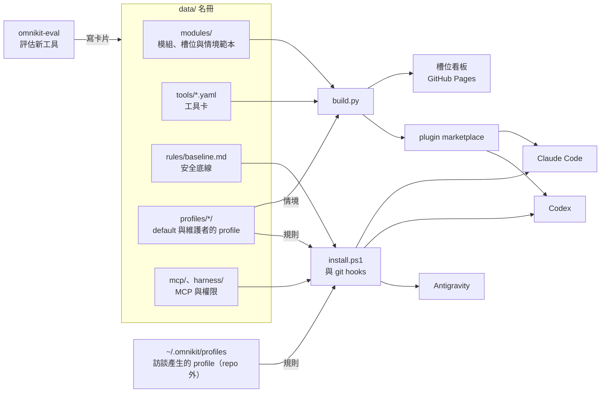
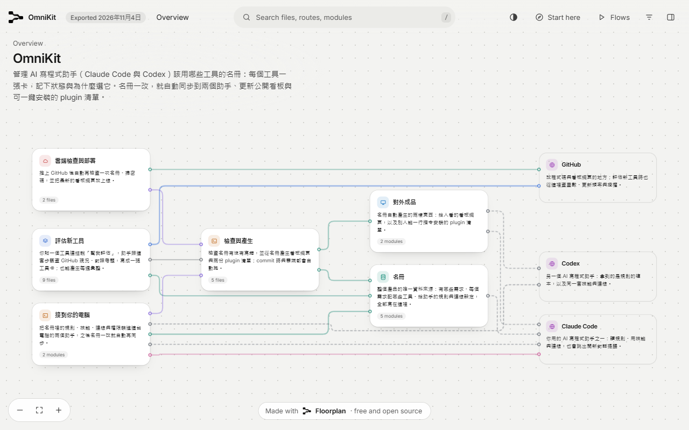

<div align="center">

# OmniKit

**讓你的 agent 設定自己汰舊換新，每個決定都有理由。**

[](https://github.com/b40609/OmniKit/actions/workflows/validate.yml)
[](https://b40609.github.io/OmniKit/)
[](LICENSE)
[](#常見問題)

[槽位看板](https://b40609.github.io/OmniKit/) · [新模型提醒](#看板與新模型提醒) · [架構地圖](https://b40609.github.io/OmniKit/map.html) · [快速開始](#快速開始) · [裝好之後](#裝好之後) · [運作方式](#運作方式) · [常見問題](#常見問題)

</div>

<picture>
  <source media="(prefers-color-scheme: dark)" srcset=".github/assets/board-dark.png">
  
</picture>

Claude Code、Codex 與 Antigravity 的 plugin、skill、MCP 每週都有新的，裝了一堆之後，很難說清楚哪個真的有用、當初為什麼選它。

OmniKit 把「該用哪個」變成一份有紀錄的名冊。每一種需求是一個**槽位**，配上幾個真實的工作情境；每個工具一張**卡片**，記下狀態、日期與理由。新工具進來時，拿槽位的情境跟現任比，比贏了才換，換的理由也會留下來。

槽位照**模組**分成三層：基礎（agent 自己怎麼運作，例如記憶、權限）、能力（agent 碰得到什麼，例如瀏覽器、Office 檔、桌面程式）、領域（一種業務要交付的成果，例如軟體開發、數據分析、計畫書、CAD、影片、金融工程）。要加一種新的業務，新增一個模組檔就好，見[新增一種業務](#新增一種業務)。

## 看板與新模型提醒

- **線上槽位看板**：[https://b40609.github.io/OmniKit/](https://b40609.github.io/OmniKit/)（由 `.github/workflows/pages.yml` 的「部署看板」自動建置部署）。
- **每週新模型差異提醒的三個出口**（Plan B 模型角色化定案，預定 2026-12-01 解凍後上線，僅提建議、不靜默換模型）：
  1. **看板首頁置頂的「新模型」區塊**：打開[槽位看板](https://b40609.github.io/OmniKit/#new-models)即可看到每週偵測到的新模型、淘汰與建議對應。
  2. **專案 `NOW.md` 的「等 Ryan 決定」**：自動整理異動清單與建議角色順位，待拍板後才寫入政策。
  3. **T3 排程任務對話（`schedule_task`）**：每週比對發現新模型或舊模型消失時直接開新對話，讓手機收到推播通知。

## 特色

- **每個決定都有理由**：卡片記下狀態（預設、試用、待評估、拒絕、退役）、決定日期與理由，過了半年還查得到當初為什麼選它。
- **用真實情境比，不看星數**：每個槽位配幾個你實際會遇到的情境，評估新工具就拿這些當考題。
- **一份設定，三個 agent**：規則、skills、MCP 只寫一次，接到 Claude Code、Codex 與 Antigravity；全由 OmniKit 自己的腳本接，不依賴第三方同步工具。
- **名冊是唯一來源**：看板與兩份 plugin marketplace 都由名冊產生，CI 會檢查它們跟名冊一致。
- **評估分層、有額度**：第 0 層免費、第 1 層便宜、第 2 層實測；每週的實測次數有上限，不會一直燒 token。
- **安全的預設**：工具固定版本並比對 SHA256、commit 前用 gitleaks 掃金鑰、安裝第三方 skill 前先掃描、權限規則只增不刪。

## 快速開始

### 直接安裝（同事用，不用 fork、不用 GitHub 帳號）

**需要：** Windows 11、[Git](https://git-scm.com/download/win)、[Node.js LTS](https://nodejs.org/)（MCP 用）、Claude Code、Codex、Antigravity 至少一個（裝了的都會接上）。不需要 GitHub 帳號，也不用開 Actions 或 Pages。

可以直接在 Claude Code 或 Codex 說「幫我安裝 OmniKit：https://github.com/b40609/OmniKit」，agent 會照下面的步驟做；也可以自己在 PowerShell 跑。

1. **Clone。** 放在之後不會搬動的地方：規則與 skills 會連到這個資料夾。

   ```powershell
   git clone https://github.com/b40609/OmniKit.git "$env:USERPROFILE\OmniKit"
   cd "$env:USERPROFILE\OmniKit"
   ```

2. **安裝。** 先加 `-WhatIf` 預覽，什麼都不會改；確認之後拿掉 `-WhatIf` 再跑一次。開始前會先做安裝前檢查（git、連得到 GitHub、npm、PyPI、proxy、防毒、PowerShell 執行原則），任一項不通過就停下來、列出處理方式，什麼都不寫入。完整清單見[安裝會改動哪些地方](#安裝會改動哪些地方)。

   ```powershell
   powershell -NoProfile -ExecutionPolicy Bypass -File engine\scripts\install.ps1 -WhatIf
   powershell -NoProfile -ExecutionPolicy Bypass -File engine\scripts\install.ps1
   ```

   這樣裝的是同事版：不設 git hook，`git pull` 不會改任何設定；讓 agent 免問就能用某個工具之前，會先問你。見[維護者版與同事版](#維護者版與同事版)。

3. **確認接上了。** 開一個新的 Claude Code 或 Codex session，問「OmniKit 規則版本與 profile 是什麼？」，版本跟 `data/rules/baseline.md` 開頭的一樣，就表示規則生效了。skill 與 MCP 怎麼檢查，見[裝好之後](#裝好之後)。

4. **建立自己的 profile。** 在新的 session 說「幫我設定 OmniKit」，回答最多 6 題，看過預覽才寫入，見[建立自己的 profile](#建立自己的-profile)。profile 存在 `~/.omnikit/profiles/<名稱>/`，不在 repo 裡，不會被 commit 或上傳。

之後要更新：`git pull`，再跑 `install.ps1 -WhatIf` 預覽、`install.ps1` 套用。`git pull` 本身不會改任何設定。

### Fork 一份自己維護（維護者用）

想換成自己的名冊、看板與 marketplace，就 fork 一份。fork 會帶著原作者已經整理好的 100 多張工具卡，可以直接當起點。另外需要 GitHub 帳號。

1. **Fork 並開啟看板。** 按本頁右上角的 **Fork**，接著在你的 fork 上：
   - **Actions** 分頁：fork 的 workflow 預設是關的，按 **I understand my workflows, go ahead and enable them**。
   - **Settings → Pages**：**Source** 選 **GitHub Actions**。

2. **Clone 你的 fork。**

   ```powershell
   git clone https://github.com/<你的帳號>/OmniKit.git
   cd OmniKit
   ```

3. **認識 profile。** agent 讀到的規則分兩層：
   - `data/rules/baseline.md` 是安全底線，所有人都套用：刪除、對外發送、付款前先確認，不碰金鑰。
   - profile 是個人層：`AGENTS.md` 寫語言、語氣、哪些事可以直接做；`scenarios.yaml` 寫評估工具用的真實情境，沒寫的槽位用模組檔（`data/modules/`）的範本。訪談產生的 profile 存在 repo 外的 `~/.omnikit/profiles/<名稱>/`；repo 裡的 `data/profiles/<名稱>/` 放 `default` 與維護者手寫、要跟著 repo 的 profile。兩邊同名時，repo 外的優先。

   不用先改檔案：先用 `default` 安裝（繁體中文、下載安裝前先問），裝好之後用[訪談](#建立自己的-profile)產生你自己的 profile。想手寫也行：複製 `data/profiles/default` 成 `data/profiles/<你的名字>` 再改，會跟著你的 fork commit；`data/profiles/ryan` 是原作者的，可以參考。

4. **安裝。** 加上 `-Edition maintainer`（指定一次就會記住）：commit 前驗證名冊、掃金鑰，commit 或 pull 後自動同步。已經有自己的 profile，就加上 `-ProfileName <名稱>`，一樣指定一次就會記住。

   ```powershell
   powershell -NoProfile -ExecutionPolicy Bypass -File engine\scripts\install.ps1 -Edition maintainer -WhatIf
   powershell -NoProfile -ExecutionPolicy Bypass -File engine\scripts\install.ps1 -Edition maintainer
   ```

   偵測到這是 fork 時，會自動把 `data/omnikit.yaml` 的 `repo`、`owner`、`marketplace` 改成你的、看板用的 `profile` 改回 `default`，並重新產生 marketplace 清單，避免跟原作者的撞名。

5. **推上去。** 推到 main 之後，GitHub Actions 會部署看板到 `https://<你的帳號>.github.io/OmniKit/`。

   ```powershell
   git commit -am "chore: 改成自己的 OmniKit"
   git push
   ```

6. **確認接上了，再建立自己的 profile。** 跟上面直接安裝的第 3、4 步一樣。

### 只想裝預設的 plugin

不用 fork，也不會動到你的其他設定。先把 OmniKit 加成 marketplace：

| | 指令 |
|---|---|
| Claude Code | `/plugin marketplace add b40609/OmniKit` |
| Codex | `codex plugin marketplace add b40609/OmniKit` |

再裝想要的 plugin，例如 frontend-design：

| | 指令 |
|---|---|
| Claude Code | `/plugin install frontend-design@omnikit-b40609` |
| Codex | `codex plugin add frontend-design@omnikit-b40609` |

目前收錄哪些，看[槽位看板](https://b40609.github.io/OmniKit/)的「安裝預設的 plugin」。

## 裝好之後

安裝不會在 Claude Code、Codex 或 Antigravity 的畫面上多出按鈕或面板。改變的是 agent 開 session 時讀到的規則，以及多了六個核心 skill（`omnikit-setup`、`omnikit-handoff`、`omnikit-dispatch`、`omnikit-research`、`omnikit-capabilities`、`omnikit-eval`，搭配 `ok`／`ok-*` 簡短入口；訪談選了不評估新工具的沒有 `omnikit-eval` 與 `ok-eval`）、一個 MCP。**已經開著的 session 不會重讀，要開新的 session 才生效。**

### 確認接上了

| 檢查 | Claude Code | Codex | Antigravity |
|---|---|---|---|
| 規則 | 問「OmniKit 規則版本與 profile 是什麼？」，版本跟 `data/rules/baseline.md` 開頭的「規則版本」一樣，profile 是你選的 | 同左 | 同左 |
| skill | 輸入 `/omnikit` 或 `/ok`，選單裡會出現 `omnikit-setup`、`omnikit-handoff` 等（訪談選了不評估新工具的，沒有 `omnikit-eval` 與 `ok-eval`） | 輸入 `$omnikit` 或 `$ok`，或用 `/skills` 列出來 | 問「你可用的 skill 有哪些？」，會列出這幾個 |
| MCP | 終端機跑 `uv run engine/scripts/doctor.py`（或 `claude plugin list` 確認 `omnikit@omnikit-local` 已啟用） | 終端機跑 `codex mcp list`，`chrome_devtools` 是 enabled | 終端機跑 `agy mcp list`，`chrome_devtools` 是 enabled |

終端機跑 `uv run engine/scripts/sync.py status`，可以看到這台接上了哪些 agent 與無帳本對帳狀態。

逐項檢查跑 `uv run engine/scripts/doctor.py`：規則區塊、skills、MCP、權限規則與 hook 都還在、跟寫入時一樣，這台每個 agent 設定目錄（多帳號、T3 Code 的實例）都接上了，並對護欄 hook 做三方言端到端自測；查不到的標「未知」，不算通過。加 `--preflight` 一併跑安裝前檢查。

### 安裝前後差在哪

| 項目 | 會有什麼不同 | 三個 agent 的差別 |
|---|---|---|
| 規則（`data/rules/baseline.md` + `data/rules/dispatch.md` + profile 的 `AGENTS.md`） | 安全底線與分派原則所有人都一樣；回覆用什麼語言、寫多詳細、哪些事可以直接做，照你選的 profile。`default` 是繁體中文、下載安裝前先問。完整分派政策在 `dispatch-policy.md`、個人帳號對應在 `dispatch.md`、行動端前端底線在 `omnikit-mobile-web` skill，都不常駐載入，需要時才讀 | Claude Code 直接 import 來源檔，改完開新 session 就生效；Codex 讀合併後的 `~/.codex/AGENTS.md` 受管區塊（<= 32 KiB）；Antigravity 拆成 `~/.gemini/AGENTS.md`（共用層）與 `~/.gemini/GEMINI.md`（個人層），單檔限制 <= 24,000 bytes 避免靜默截斷。改了 profile 跑 `uv run engine/scripts/profiles.py` 重新接上（維護者版 commit 時 git hook 自動同步） |
| `ok`／`ok-*` 簡短入口 | 少打字的快捷選單與捷徑：`ok` 列出 5 項主選單（交接、調研、分派、設定、清點），或直接呼叫 `ok-handoff`、`ok-research`、`ok-dispatch`、`ok-setup`、`ok-eval` | Claude Code 與 Antigravity 輸入 `/ok`（如 `/ok 交接`），Codex 輸入 `$ok` |
| `omnikit-setup` skill | 說「幫我設定 OmniKit」，agent 先掃描這台的環境，再問最多 6 題，產生你自己的 profile 並接上。見[建立自己的 profile](#建立自己的-profile) | 三邊說「幫我設定 OmniKit」都會觸發；要手動叫，Claude Code 輸入 `/omnikit-setup` 或 `/ok-setup`，Codex 輸入 `$omnikit-setup` |
| `omnikit-handoff` skill | 說「交接」，agent 把做到一半的工作 commit、push，寫一份交接檔到你的狀態 repo，再開新對話接著做；新對話說「讀 <交接檔路徑> 接著做」就照交接檔接手。狀態 repo 的位置寫在你的 profile，沒寫 agent 會先問 | 三邊說「交接」都會觸發；要手動叫，Claude Code 輸入 `/omnikit-handoff` 或 `/ok-handoff`，Codex 輸入 `$omnikit-handoff` |
| `omnikit-dispatch` skill | 派子任務、開子對話時照分派政策選模型與思考程度，收完結果後記一行委派紀錄（存在這台，不上傳）；也能看 Sonnet 試行的比較與本週 Claude 用量。見[子任務分派與委派紀錄](#子任務分派與委派紀錄) | 三邊說「委派紀錄」「分派統計」都會觸發；要手動叫，Claude Code 輸入 `/omnikit-dispatch` 或 `/ok-dispatch`，Codex 輸入 `$omnikit-dispatch`。本週用量的快照只有 Claude Code 的狀態列存得到 |
| `omnikit-research` skill | 說「先查業界做法」「找同類工具」「比較方案」，agent 每個管道都查（網頁中英文、GitHub topic 與星數、fork 與競品、skill／MCP 目錄、Hacker News、Product Hunt），關鍵字從結果擴展，連續 3 組沒有新名字才停（長尾題目改看 ★1,000 以上的名字，標「長尾未飽和」；12 組還沒停先回報）；報告附查了哪些管道與關鍵字、第幾組停、哪裡查不到，星數與授權用 `gh api` 實測並寫日期。安全底線有一行要求調研照這個 skill 做 | 三邊說「找同類工具」「調研」都會觸發；要手動叫，Claude Code 輸入 `/omnikit-research` 或 `/ok-research`，Codex 輸入 `$omnikit-research`。GitHub 的管道要先 `gh auth login` |
| `omnikit-capabilities` skill | agent 要說「做不到」「沒有工具」「請你手動做」之前，先清點這台能用的 CLI（標出 Git Bash 找不到、只有 PowerShell 找得到的，例如只有 `t3.cmd` 的 T3）、各 agent 登記的 MCP server、本機 MCP 端點（開著沒、要不要登入、哪個 agent 還沒接），列出最省事的做法，再對照 `--help` 與最新官方文件。只看檔案、PATH 與本機連線，不印金鑰。安全底線的「說做不到之前」要求先照這個 skill 查完 | 三邊要說做不到、或使用者問「你能不能…」「有沒有辦法派給…」時觸發；要手動叫，Claude Code 輸入 `/omnikit-capabilities`，Codex 輸入 `$omnikit-capabilities`。也能直接跑 `uv run engine/scripts/capabilities.py` |
| `omnikit-eval` skill | 貼 GitHub 連結說「幫我評估」，agent 會查 GitHub 現況、對照槽位情境，寫成 `data/tools/` 裡的工具卡；「每週彙整」是維護者評估工具用的 | 三邊說「幫我評估」都會觸發；要手動叫，Claude Code 輸入 `/omnikit-eval` 或 `/ok-eval`，Codex 輸入 `$omnikit-eval`。三邊皆透過無複製參照指向 `~/.omnikit/current/engine/skills`（維護者版 commit 時由 git hook 自動更新，同事版重跑 `install.ps1`） |
| `chrome_devtools` MCP | agent 能自己開瀏覽器：開網頁、截圖、看 console 與網路請求。每次用暫時的瀏覽器設定檔，碰不到你的登入狀態 | Claude Code 由薄 plugin 掛載並可加進免問清單，Codex 設成自動核准（同事版皆需本人同意），Antigravity 由薄 plugin 掛載並照它自己的權限設定 |
| 護欄與提醒 hooks | 包含確定性安全護欄（`harness_hooks.py`，攔截危險繞過與敏感檔讀取）、開新對話提醒（`session_nudge.py`，含每日最多一則用法小提示）、說做不到查證（`claim_check.py`，未附查證擋回一次；設 `OMNIKIT_CLAIM_CHECK=off` 可暫關）、設定目錄檢查（`home_watch.py`）與 T3 MCP 斷線防護（`t3_watch.py`） | Claude Code 透過本地薄 plugin `omnikit@omnikit-local` 掛載（所有 Claude 設定目錄皆接）；Codex 寫進 `config.toml`（需在 `/hooks` 信任才會跑）；Antigravity 於薄 plugin `config/plugins/omnikit/hooks.json` 掛載確定性護欄 |
| git hooks（只有維護者版） | 只作用在 OmniKit repo：commit 前掃金鑰、驗證名冊；commit 或 pull 動到規則、profile、MCP、權限時自動同步。同事版不設 | 跟 agent 無關 |

開新的 session 試試看：

```text
OmniKit 規則版本與 profile 是什麼？
幫我設定 OmniKit
/ok
幫我評估 https://github.com/<owner>/<repo>
用瀏覽器打開 http://localhost:3000，看 console 有沒有錯誤
```

需求還沒想清楚想先對焦，直接用內建 `/plan`（Antigravity 亦可用 `/grill-me`），三家內建指令對照見 [docs/cli-features.md](docs/cli-features.md)；換 profile、簡短入口、分派、評估、改名冊與跟上更新，見[日常使用](#日常使用)。

### 建立自己的 profile

在新的 session 說「幫我設定 OmniKit」。`omnikit-setup` 會：

1. **掃描**：列出這台裝了哪些 agent、目前的規則、skills 與 MCP（只看名稱與版本，不讀金鑰）；另外依你現在的專案資料夾裡的檔名（只看檔名），預選第 1 題的領域。
2. **訪談**：最多 6 題，大多是選擇題：做哪幾種工作（領域，可複選）、最想改善的習慣、回覆的語言與詳略、agent 可以自己做到哪、要不要評估新工具、主要專案。
3. **預覽**：先給你看產生的規則，同意才寫入。
4. **建立並套用**：寫進 repo 外的 `~/.omnikit/profiles/<名稱>/`，接上這台接好的 agent，開新 session 生效。

| 你選的 | 規則裡寫成 |
|---|---|
| 做哪幾種工作（領域） | 不寫進規則，存成 `domains.yaml`，記錄你選的領域、它們帶入的能力（例如軟體開發會帶入瀏覽器），以及每個人都有的基礎模組。之後想改，重新訪談或直接改這個檔；刪掉這個檔就是不限領域 |
| agent 可以自己做到哪 | 每步先問：改檔案、執行指令前先列計畫等你同意。專案內直接做（建議）：下載安裝、改專案以外的才先問。大多放手：下載安裝也直接做 |
| 最想改善的習慣 | 例如「常改太多」變成「只改需求相關的地方，其他想改的先列出來問你」 |
| 要評估新工具 | 情境範本裡的 `<你的專案>` 換成你的專案，評估工具時拿來當考題 |
| 不評估新工具 | 不裝 `omnikit-eval` 與對應捷徑 `ok-eval`（評估工具與維護者的每週彙整都在這個 skill 裡）；已經裝了的會拿掉。之後改主意，重新訪談選「要」就會裝回來 |

規則檔與情境檔都由 `engine/scripts/profile_new.py` 依固定範本產生、驗證，agent 只負責問問題；寫入後可以直接改，改完跑 `uv run engine/scripts/profiles.py` 重新接上。重新訪談時會帶入上次的答案，舊檔先備份成 `.bak`；手寫的 profile 與 repo 裡已經有的名稱不會被覆蓋。安全底線不能從 profile 放寬。

profile 存在 repo 外的 `~/.omnikit/profiles/<名稱>/`（`AGENTS.md`、`scenarios.yaml`、`domains.yaml`，以及下次訪談預填用的 `answers.json`），不會被 commit、push 或上傳，在 repo 裡跑 `git status` 也看不到。舊版存在 repo 裡（`data/profiles/<名稱>/`）的，重跑 `install.ps1` 或說「幫我設定 OmniKit」時會問你要不要搬過去；搬好、確認內容一樣才刪 repo 裡的舊檔，不同意就不動。

### 預設 plugin 要另外裝

`install.ps1` 不會把 OmniKit 加成 marketplace，也不會安裝看板上的預設 plugin。想用的話，照[只想裝預設的 plugin](#只想裝預設的-plugin) 的指令裝。用自己的 fork 時：

- 把指令裡的 `b40609/OmniKit` 換成你的 fork。
- `@` 後面的 marketplace 名稱換成你 `data/omnikit.yaml` 的 `marketplace`，例如 `omnikit-<你的帳號小寫>`。
- 先 push 到 GitHub，marketplace 才讀得到最新的清單。

## 運作方式



1. **評估**：把工具的 GitHub 連結貼給 agent，`omnikit-eval` 會查 GitHub 現況、對照槽位情境，寫成一張工具卡。
2. **產生**：commit 時 git hook 驗證名冊並重新產生 marketplace 清單；推到 main 之後，GitHub Actions 重建看板。
3. **同步**：`install.ps1` 透過無帳本同步器（`engine/scripts/sync.py`）把規則（安全底線 + 你選的 profile）、skills、hooks 與 MCP 接到 Claude Code、Codex 與 Antigravity。維護者版之後 commit 或 pull 動到這些檔案時，git hook 會自動再同步；同事版不設 git hook，pull 不會改任何設定。

想看每個部分、每個檔案在做什麼，打開[互動架構地圖](https://b40609.github.io/OmniKit/map.html)：每個檔案都有白話說明，另有 3 條逐步導覽（評估新工具、改規則、第一次安裝）。建議用電腦開。（註：`map.html` 為早期架構快照，最新無帳本同步架構與檔案清單以本頁[安裝會改動哪些地方](#安裝會改動哪些地方)與[目錄結構](#目錄結構)為準。）

<a href="https://b40609.github.io/OmniKit/map.html">
<picture>
  <source media="(prefers-color-scheme: dark)" srcset=".github/assets/map-dark.png">
  
</picture>
</a>

## 安裝會改動哪些地方

| 位置 | 做什麼 |
|---|---|
| `%LOCALAPPDATA%\Programs\` | 安裝固定版本的 uv、gh，以及維護者版才裝的 gitleaks；比對 SHA256，不改 PATH。這台已經有 uv、gh 就沿用 |
| `data/omnikit.yaml` | fork 出來的 repo，改成你的 `repo`、`owner`、`marketplace`，`profile` 改回 `default`，並重新產生 marketplace 清單 |
| `~/.claude/CLAUDE.md` | 在開頭加一段受管區塊，import `data/rules/baseline.md` 與你選的 profile 的 `AGENTS.md`（訪談產生的在 `~/.omnikit/profiles`，其他在 `data/profiles`）；路徑有空白時用 `\ ` 跳脫，不然 Claude Code 讀到空白就斷掉。其他內容不動 |
| `~/.codex/AGENTS.md` | 在開頭加一段受管區塊，放底線與 profile 接在一起的內容；原本的規則留在區塊外，照常生效，也先備份成 `AGENTS.md.pre-omnikit`。舊版整份換掉的，同步時換成只有區塊（規則內容一樣）；區塊被拿掉的話，同步時不加回去 |
| `~/.gemini/AGENTS.md`、`~/.gemini/GEMINI.md` | Antigravity 的規則：拆成 `AGENTS.md`（共用層）與 `GEMINI.md`（個人層）兩份受管區塊，強制檢查單檔 <= 24,000 bytes 避免靜默截斷；原本的內容留在區塊外，先備份成 `.pre-omnikit`。原地改寫，避免硬連結斷裂 |
| `~/.claude/skills`、`~/.codex/skills` | `engine/skills` 的每個 skill 用 Directory Junction 連結至 `~/.omnikit/current/engine/skills`（加 `--dev` 則直連工作區），零檔案複製與零雜湊帳本 |
| `~/.gemini/config/skills.json` | Antigravity 的（App、IDE、CLI 與 T3 Code 實例共用）：原生參照實體 skills 路徑，T3 自動同步至全部實例 |
| `~/.omnikit/claude-marketplace`、`~/.codex/config.toml`、`~/.gemini/config/plugins/omnikit/` | 無帳本掛載 `data/mcp/servers.yaml` 的 MCP server 與護欄 hooks：Claude 安裝本地薄 plugin `omnikit@omnikit-local`；Codex 用 `codex mcp` CLI 與 `config.toml` hooks；Antigravity 與各 T3 實例放置三檔薄 plugin 宣告（不動頂層 `mcp_config.json`，保留 T3 自動標題生成） |
| `~/.omnikit/`（Windows 是 `%USERPROFILE%\.omnikit`；可用環境變數 `OMNIKIT_STATE_DIR` 改位置） | 不放 `%LOCALAPPDATA%`：從 Claude 桌面版這類 MSIX 封裝的 app 裡跑時，那裡新建的檔會被轉存成另一份；舊版留在 `%LOCALAPPDATA%\omnikit` 與轉存副本的，安裝、同步時會合併過來（原檔備份在 `legacy\`）。`current/` 是保護工作區免受穿透刪除的乾淨 git clone；`profiles/<名稱>/` 是訪談產生的 profile（個人資料，不在 repo 裡；移除時也不刪）；`profile.json` 記這台選的 profile；`edition.json` 記這台是維護者版還是同事版；`consent.json` 記你同意了哪些工具免問；`config.json` 記啟用的 agent 與明確列舉的額外設定目錄 |
| 舊版的 skillshare | 以前用 skillshare 接的電腦，重跑 `install.ps1` 會改由 OmniKit 接手，並拿掉 skillshare 設定裡 OmniKit 的部分；skillshare 本身不刪 |
| npm 全域套件 | 安裝 `data/mcp/packages.txt` 指定的固定版本 |
| `~/.claude/settings.json` | 把 `data/harness/claude-allow.txt` 的規則補進 `permissions.allow`（現行＋墓碑清單管理，只增不刪使用者自訂規則；同事版只補你同意過的工具），並設定 `statusLine`。hooks 優先透過本地薄 plugin `omnikit@omnikit-local` 提供（找不到 `claude` CLI 時才退回 `settings.json` hooks 備案） |
| 其他設定目錄 | 多帳號或啟動器另外指定的設定目錄（`CLAUDE_CONFIG_DIR`、`CODEX_HOME`、T3 Code 每個實例的 homePath、以及 `config.json` 明確列舉的額外目錄，`engine/scripts/homes.py` 找）：規則區塊、MCP、skills、權限規則與 hook 都跟預設目錄一樣寫。Claude 的其他設定目錄另外無帳本同步你自己裝在 `~/.claude` 的東西：`~/.claude/skills` 的第三方 skill 用 Directory Junction 連過去（`.bak-*` 這類備份、`.` 開頭的、無 `SKILL.md` 的系統目錄不連），`~/.claude/settings.json` 啟用中的第三方 plugin 用官方的 `claude plugin marketplace add` 與 `claude plugin install`（`CLAUDE_CONFIG_DIR` 指到那個目錄）裝進去，停用的不裝；設定檔其他欄位與金鑰不碰。之後在 `~/.claude` 新裝的，重跑 `uv run engine/scripts/sync.py sync`（只同步 plugin：`--plugins`）就補上 |
| T3 Code Antigravity 實例 | T3 Code 0.1.11 起原生同步 `~/.gemini` 的規則與 `skills.json`；OmniKit 會在每個實例補上 `config/plugins/omnikit/` 薄 plugin（確定性護欄與 MCP），並自動清理早期版本遺留的 `~/.omnikit/acp/` 轉接程式與 `binaryPath` 設定 |
| 這個 repo | 維護者版：`core.hooksPath` 指到 `.githooks`，commit 前掃金鑰、驗證名冊；commit 或 pull 動到規則、profile、skills、MCP、權限、提醒 hook 時自動同步。同事版不設 git hook |
| `~/.omnikit/install-record.json` | 安裝紀錄：記下這台原本沒有、由 OmniKit 裝上的工具、npm 套件與權限規則，移除時只動這些 |

加上 `-Fresh` 會把 `~/.claude/CLAUDE.md` 受管區塊以外的舊規則移除（先備份成 `CLAUDE.md.pre-omnikit`），適合想讓 OmniKit 的規則完全取代舊規則的人。

### 維護者版與同事版

兩版的規則、skills、MCP 接法都一樣，只差下面三件事。用 `install.ps1 -Edition maintainer` 或 `-Edition colleague` 指定，指定一次就會記住；沒指定過的話，分版之前就裝過的電腦是維護者版，其他都是同事版。

| | 維護者版 | 同事版（預設） |
|---|---|---|
| git hook | commit 前掃金鑰、驗證名冊；commit 或 pull 後自動同步。在 git worktree（例如 `.claude/worktrees/` 底下）裡只掃金鑰、驗證名冊，不同步，合進 main 後由主 checkout 同步 | 不設。pull 不會改任何設定；要套用更新，先跑 `install.ps1 -WhatIf` 預覽，再跑 `install.ps1` |
| 免問核准 | 照 `data/harness/claude-allow.txt` 與 `data/mcp/servers.yaml` 寫入，那是維護者自己同意的 | 每個工具先問你，同意了才寫入（預設否）。之後可以改：`uv run engine/scripts/sync.py approvals` 查看，`--grant <名稱>` 同意、`--revoke <名稱>` 撤回 |
| gitleaks | 裝，給 pre-commit 用 | 不裝 |

看這台是哪一版：`uv run engine/scripts/edition.py`。

## 移除

```powershell
powershell -NoProfile -ExecutionPolicy Bypass -File engine\scripts\uninstall.ps1
```

會先列出要做的事，確認後才動手：

- 三個 agent 的規則、skills、MCP，以及權限、git hook 還原成安裝前的樣子，安裝前的備份會放回原位；只拿掉 OmniKit 的，其他的不碰。
- 只移除安裝紀錄裡、由 OmniKit 裝上的工具與 npm 套件；安裝前就有的都保留。
- 加 `-KeepTools` 只還原設定、保留工具；加 `-Yes` 不詢問直接移除。
- repo 資料夾與訪談產生的 profile（`~/.omnikit/profiles`）不會刪，重新安裝就能接著用；不需要的話自己刪掉即可。

## 日常使用

### 換 profile

```powershell
uv run engine/scripts/profiles.py --show          # 這台現在用哪個
uv run engine/scripts/profiles.py --set <名稱>    # 換成這個 profile，接上的 agent 一起換
uv run engine/scripts/profiles.py --migrate       # 舊版存在 repo 裡的 profile 搬到 repo 外（先問你）
```

找 profile 時先找 repo 外的 `~/.omnikit/profiles/<名稱>`，再找 repo 裡的 `data/profiles/<名稱>`。換完開新的 session 才生效。skills 也會跟著同步：換到訪談選了不評估新工具的 profile，`omnikit-eval` 會拿掉，換回來再裝上。還沒選過的電腦會一直用 `default`，並在安裝與同步時提醒。想重新訪談、改掉原本的答案，說「幫我設定 OmniKit」就好。

### 簡短指令（`ok` 與 `ok-*`）

不想記完整 skill 名稱時，直接打總入口 `/ok`（Claude Code、Antigravity）或 `$ok`（Codex），會列出 1 到 5 號選單（交接、調研、分派、設定、清點），也可以直接帶參數或用對應捷徑：

| 指令（Claude／Antigravity；Codex 改用 `$`） | 對應 skill |
|---|---|
| `/ok` | 列出主選單，回編號執行 |
| `/ok-handoff`（或 `/ok 交接`） | `omnikit-handoff`（交接、接手與更新 `NOW.md`） |
| `/ok-research`（或 `/ok 調研`） | `omnikit-research`（飽和式調研） |
| `/ok-dispatch`（或 `/ok 分派`） | `omnikit-dispatch`（子任務分派與委派紀錄） |
| `/ok-setup`（或 `/ok 設定`） | `omnikit-setup`（訪談建立個人 profile） |
| `/ok-eval`（或 `/ok 評估`） | `omnikit-eval`（評估新工具；選不評估時不裝） |

### 本機 Cockpit 多專案面板（個人進階功能，同事版預設不啟用）

同時開多個專案與狀態板（`NOW.md`）時，可以用本機指揮台一次看清「等你決定／待收尾／執行中／停泊」與過期提醒。這屬於個人進階功能，同事版安裝時預設不會啟用也不會註冊開機自啟：

```powershell
uv run scripts/cockpit.py snapshot            # 終端機檢視所有已註冊專案現況
uv run scripts/cockpit.py serve --open        # 啟動本機網頁面板（預設 127.0.0.1:3780）
uv run scripts/cockpit.py register --name <專案> --path <目錄>
uv run scripts/cockpit.py autostart --status  # 查詢／管理 Windows 登入自啟（--install / --uninstall）
```

### 診斷、小提示與已停用項目

- **用法小提示**：主線對話第一回合結束時由 `session_nudge.py` 呼叫 `engine/scripts/tips.py`（內容在 `data/tips.json`）講一則官方功能小提示，一天最多一則、每則只講一次；Claude Code 第一次 `git push` 時若 `/insights` 超過 14 天沒跑會提醒一次。設環境變數 `OMNIKIT_NO_NOTIFY` 可關閉。
- **系統檢查與起步清單**：原週報、建議、替換、回流、訊號與對話掃描等舊腳本已於 `6359488` 移除，原問法庫 `omnikit-ask` 已於 `87bbb81` 退役刪除（改用各家內建 `/plan` 或 `/grill-me`）。檢查工具用量與使用習慣請改用官方 `/doctor`、`/usage`、`/insights`，三家內建功能對照見 [docs/cli-features.md](docs/cli-features.md)，新電腦該裝什麼看 [docs/starter.md](docs/starter.md)。

### 子任務分派與委派紀錄

派子任務或開子對話時，用哪個管道、哪個模型、多少思考程度，分成兩層寫：

| 層 | 檔案 | 寫什麼 |
|---|---|---|
| 共用（所有人） | `data/rules/dispatch.md`（原則，常駐載入）與 `data/rules/dispatch-policy.md`（完整政策，要派才讀） | 任務類型 → 級別（中、高、更高、獨立驗收）→ 模型類別 → 思考程度 → 升級路徑；管道怎麼選；Sonnet 試行的品質保護；委派紀錄的欄位 |
| 個人（profile） | profile 資料夾的 `dispatch.md` | 你有哪些供應商實例（T3 的 providerInstanceId）、每個模型類別用哪個；沒有這份就只用原生子代理 |

共用層 `data/rules/dispatch.md` 會跟安全底線、profile 的 `AGENTS.md` 一起常駐載入三個 agent；完整政策 `dispatch-policy.md` 與個人層 `dispatch.md` 不佔常駐規則字數，需要派工時由 `engine/scripts/dispatch.py` 讀取。改共用層要更新 `data/rules/baseline.md` 的規則版本（同事版套用更新重跑 `install.ps1` 或 `uv run engine/scripts/profiles.py`）。

**設定自己的帳號對應。** 在你的 profile 資料夾（訪談產生的在 `~/.omnikit/profiles/<名稱>/`）新增 `dispatch.md`。實例 id 用 T3 的 `orchestrator_capabilities` 查（列出的 `providerInstanceId`），`classes` 只能寫共用層 `model_classes` 裡有的類別，而且要跟實例的 driver 對得上：

````markdown
# 個人分派設定：<名稱>

```yaml
instances:
  claudeAgent:  {driver: claudeAgent, account: 我的 Claude, classes: [claude-fable, claude-opus, claude-sonnet]}
  antigravity:  {driver: antigravity, account: 我的 Google, classes: [gemini-carbon, gemini-pro, gemini-fast, antigravity-opus]}
```
````

寫完跑 `uv run engine/scripts/dispatch.py check` 檢查，再跑 `uv run engine/scripts/dispatch.py show` 看套上之後每一級會用什麼。`data/profiles/ryan/dispatch.md` 是完整的例子。

**沒有 Gemini／Antigravity，只用 Claude。** 不用寫 `dispatch.md`。沒有實例的類別與跨家第二意見會自動跳過（不會出現同模型自己審自己）：中級讀檔／雜務用 Opus（effort medium）、日常多檔／UI 用 Opus（effort high，退路 Sonnet medium），高級重要統整與改動首選 Fable 5.2（effort high；方案不支援或達 80% 用量時退回 Opus high），更高與獨立驗收用 Opus（effort xhigh），重大架構用 Fable 5.2（effort high），沒有跨家第二意見；「本週用量 80% 改派 Antigravity」那條也不會用到。只有其他 Claude 帳號要給 `delegate_task` 指定時，才需要寫 `claudeAgent` 類的實例。

**委派紀錄。** 子任務結果收回、驗收完、settle 之前，agent 用 `omnikit-dispatch` skill 記一行到 `~/.omnikit/dispatch/log.jsonl`：時間、專案名稱、任務類型、級別、管道、供應商實例、模型類別與模型、思考程度、是否一次通過、重試次數、升級次數、最後過關的類別、驗收結論、規則版本、profile。只存在這台，不進 repo、不上傳；專案只記資料夾名稱。目前是規則要求 agent 寫，不是 hook 自動寫：一次通過、驗收結論這些只有主對話知道。

```powershell
uv run engine/scripts/dispatch.py stats     # 依級別與模型類別的一次通過率，以及 Sonnet 試行的判定
```

**Sonnet 試行。** 中級要用 Claude 時改派 Sonnet（effort medium）。品質保護：Sonnet 的產出照常驗收，不過就用 Opus、同一級 effort 重跑，記成升級；Sonnet 累積 20 筆後，跟 Opus 同級的一次通過率比，低 10 個百分點以上就退回 Opus。`stats` 會照這條判定，但不會自己改規則。

**本週 Claude 用量（給高級的 80% 條件）。** 官方的來源是 Claude Code 狀態列的 JSON 輸入 `rate_limits.seven_day.used_percentage`（只有 Pro、Max、Ultra 訂閱，而且要對話第一個回應之後才有）。要讓 OmniKit 讀得到，把狀態列設成 `dispatch.py statusline`；原本有狀態列的，用 `--then` 串在前面，原本的輸出照樣顯示。在 `~/.claude/settings.json`（或你的 `CLAUDE_CONFIG_DIR`）加：

```json
"statusLine": { "type": "command", "command": "uv run --quiet <OmniKit 路徑>/engine/scripts/dispatch.py statusline --then \"<原本的指令>\"" }
```

快照存在 `~/.omnikit/dispatch/claude-usage.json`，依帳號的設定資料夾分開；`uv run engine/scripts/dispatch.py usage` 讀它。沒有快照、快照的這一週已經重置，就回報「未知」，agent 不會假設已達 80%。T3 透過 Agent SDK 跑 Claude 時狀態列會不會執行還沒實測（待驗證），所以只用 T3 的話，這個訊號可能一直是未知。

### 評估新工具

在 Claude Code、Codex 或 Antigravity 裡直接說（訪談選了評估新工具才有；「每週彙整」是維護者看評估額度與評估漏斗用的）：

```text
幫我評估 https://github.com/<owner>/<repo>
這個跟現在用的比一下
每週彙整
```

| 層 | 成本 | 做什麼 |
|---|---|---|
| 0 | 免費 | GitHub 現況、名冊比對、硬性門檻、安全掃描 |
| 1 | 便宜 | 讀 README，對照槽位情境寫卡片，狀態是「待評估」 |
| 2 | 實測 | 拿槽位情境實際跑一遍並評分，點名才跑；紀錄放在 `data/evals/` |

### 無帳本對帳與檢查

OmniKit 採用無狀態對帳（不維護 `agents.json` 或 `.omnikit.json` 雜湊帳本），所有期望狀態皆由 repo 內的 manifest（`data/rules/`、`engine/skills/`、`data/mcp/servers.yaml`、`data/harness/claude-allow*.txt`）直接計算：

- **Claude Code 與 Antigravity 的 MCP／hooks**：包裝在獨立薄 plugin 目錄（`omnikit@omnikit-local` 與 `config/plugins/omnikit/`），不與你自己在頂層 `.claude.json` 或 `mcp_config.json` 設定的其他 server 混寫衝突。
- **Codex 的 MCP**：透過 `codex mcp` CLI 對帳設定，不會抹掉其他自訂 server。

想在不修改任何檔案的前提下檢查本機設定與端到端護欄健康狀態：

```powershell
uv run engine/scripts/sync.py sync --check   # 純唯讀對帳，有差異回傳 exit 1
uv run engine/scripts/doctor.py              # 全面健康檢查（含三方言 hook 端到端自測與 T3 實例檢查）
```

### 新增一種業務

槽位寫在模組檔裡，一個模組一個檔：`data/modules/<層>/<id>.yaml`。

| 層 | 放什麼 | 例子 |
|---|---|---|
| `foundation` 基礎 | agent 自己怎麼運作，做什麼工作都會遇到 | 對話與記憶、輸出與品質 |
| `capability` 能力 | agent 要碰得到某種東西才做得了事；不只一個領域會用到才獨立出來 | 瀏覽器、文件與簡報檔、桌面程式 |
| `domain` 領域 | 一種業務要交付的成果 | 軟體開發、計畫書與專案管理、CAD 與機構設計 |

要加一種新的業務：

1. 複製一個現成的領域模組（例如 `data/modules/domain/video.yaml`）成新檔，檔名就是模組的 `id`。
2. 改名稱與一句說明，再列出槽位。一個槽位是一件要交付的工作，用動作加成果命名（「撰寫計畫書」「粗剪」），不是工具的類別；一個模組 3 到 6 個槽位。
3. 每個槽位至少寫一個情境，寫成可以實測的任務；`search` 填找工具用的關鍵字。
4. 需要瀏覽器、Office 檔這類能力，在 `requires` 列出能力模組的 `id`。
5. 跑 `uv run engine/scripts/validate.py` 檢查，再 commit。

規則：模組、槽位、情境的 `id` 在整份名冊裡都不能重複；情境 `id` 是 1 到 3 個大寫字母加數字（`PR1`、`CD4`）。任職單位或個人專屬的內容（補助單位的範本、公司內的規定）不要寫進模組檔，寫在自己 profile 的 `scenarios.yaml`。

### 槽位的答案

同一件工作在不同 agent 上的答案可以不一樣，寫在槽位的 `answers`，Claude Code 與 Codex 分開：

```yaml
answers:
  claude:
    verdict: native        # 內建的就夠
    reason: 實測的結論，一句話
    evidence: data/evals/<實測紀錄>.md
    decided_at: '2026-11-11'
  codex:
    verdict: tool          # 建議裝 tool 指的那張卡
    tool: chrome-devtools-mcp
    reason: 為什麼內建的不夠
    decided_at: '2026-11-11'
```

| `verdict` | 意思 | 要填什麼 |
|---|---|---|
| `native` | 內建的就夠 | `reason`、`decided_at` |
| `tool` | 建議裝某張卡 | `tool`、`reason`、`decided_at`；那張卡要放在這個槽位，而且支援這個 agent |
| `none` | 找過了，沒有好選擇 | `reason`、`decided_at` |
| `unknown` | 還沒實測 | 可以先在 `reason` 寫這個 agent 內建的功能是什麼 |

沒列的 agent 就是還不知道；看板與評估紀錄會據此標明各槽位應該用內建功能還是外裝工具。目前有實測的只有瀏覽器。

### 改名冊

改完 `data/` 直接 commit：維護者版的 pre-commit hook 會驗證名冊，並重新產生 marketplace 清單一起放進 commit。要手動檢查：

```powershell
uv run engine/scripts/validate.py
uv run engine/scripts/build.py --site _site
```

uv 不在 PATH 上的話，把 `uv` 換成 `& "$env:LOCALAPPDATA\Programs\uv\uv.exe"`。CI 會再檢查名冊、marketplace 清單是不是最新、看板能不能產生，並用 gitleaks 掃金鑰。

### 更新架構地圖

`engine/site/map.html` 是用 [Floorplan](https://github.com/haydenschmitty/floorplan) 在本機產生後匯出的，CI 不會重畫。`engine/` 有結構上的改動時，在裝了 Floorplan 的 Claude Code 裡說「更新 floorplan」，再匯出並 commit：

```powershell
node floorplan/serve.mjs --export engine/site/map.html
```

`floorplan/` 本身不進 git；換電腦後第一次要重畫整張地圖。

### 跟上原作者的更新

在你的 fork 頁面按 **Sync fork**，或在本機：

```powershell
git remote add upstream https://github.com/b40609/OmniKit.git   # 只要做一次
git pull upstream main
```

- `data/` 有衝突時，留你自己的版本。
- 兩份 marketplace 清單有衝突時，直接重新產生：`uv run engine/scripts/build.py --marketplace-only`。
- `engine/` 有更新時，重跑一次 `install.ps1`。

## 目錄結構

```text
data/                        資料：fork 後換成你的
  omnikit.yaml               看板與 marketplace 的公開設定
  modules/<層>/<id>.yaml     模組：一個檔裡有幾個槽位與情境範本。層有三種：
                             foundation（基礎）、capability（能力）、domain（領域）
  tools/<id>.yaml            名冊，一個工具一張卡
  rules/baseline.md          安全底線，所有人都套用
  rules/dispatch.md          子任務分派的原則（常駐載入，幾行）
  rules/dispatch-policy.md   子任務分派的完整政策（級別、模型、思考程度、升級、委派紀錄；要派才讀）
  rules/budget.yaml          常駐規則與自動觸發 skill 描述的 bytes 預算棘輪上限
  rules/patches.yaml         常駐規則中屬於「模型能力補丁」的旁註與退役檢驗條件
  rules/mobile-web.md        行動端底線轉址說明（內容已移入 omnikit-mobile-web 按需 skill）
  tips.json                  對話開頭的用法小提示（新的官方功能加在這裡）
  profiles/<名稱>/           跟著 repo 的 profile：個人規則（AGENTS.md）、真實情境（scenarios.yaml）、分派用的實例（dispatch.md，可省略）；
                             default 是沒選時的預設。訪談產生的存在 repo 外（~/.omnikit/profiles）
  mcp/                       MCP server 定義與 npm 套件版本
  harness/                   Claude Code 免問的現行與墓碑權限規則
  evals/                     實測紀錄
docs/                        參考文件
  cli-features.md            三家 CLI 內建功能與指令對照表
  starter.md                 新電腦起步清單
engine/                      引擎：不用改
  cockpit/                   本機 Cockpit 多專案面板後端與前端（個人進階功能，同事版預設不啟用）
  schema/                    名冊與槽位的 JSON Schema
  scripts/                   安裝與移除（install.ps1／uninstall.ps1）、無帳本同步與健康檢查（sync.py／doctor.py）、profile 與帳號池、子任務分派、能力清點、名冊驗證與看板建置、護欄與提醒 hook
  site/                      看板的樣式與程式，以及匯出的架構地圖（map.html）
  skills/ok/、ok-*/          總入口選單與簡短指令捷徑（/ok、$ok、ok-handoff 等）
  skills/omnikit-setup/      訪談建立個人 profile 的 skill
  skills/omnikit-eval/       評估新工具的 skill
  skills/omnikit-handoff/    交接與接手的 skill
  skills/omnikit-dispatch/   子任務分派與委派紀錄的 skill
  skills/omnikit-research/   飽和式調研（查同類工具、比較方案）的 skill
  skills/omnikit-capabilities/ 說做不到之前的能力清點（指令、MCP、本機端點）的 skill
  skills/omnikit-mobile-web/ 行動端（iOS Safari／WebKit）與桌面 WebApp 工程底線按需 skill
scripts/                     頂層工具入口（含本機 Cockpit 多專案面板 scripts/cockpit.py）
.claude-plugin/              Claude Code 的 marketplace（由名冊產生，不要手改）
.agents/plugins/             Codex 的 marketplace（由名冊產生，不要手改）
```

## 常見問題

<details>
<summary><b>裝好了，卻看不出有什麼不同？</b></summary>

安裝改的是規則、skill 與 MCP，畫面上不會多出東西，而且要開新的 session 才生效。照[確認接上了](#確認接上了)檢查一遍。預設 plugin 不會自動安裝，見[預設 plugin 要另外裝](#預設-plugin-要另外裝)。

</details>

<details>
<summary><b>會不會蓋掉我原本的設定？</b></summary>

不會直接蓋掉。`~/.claude/CLAUDE.md` 與 `~/.gemini/GEMINI.md` 只加一段受管區塊；`~/.codex/AGENTS.md` 第一次接上時會先備份；MCP 與權限都是合併寫入，同名但不是 OmniKit 的 skill 也不碰。只有加上 `-Fresh` 才會移除 CLAUDE.md 的其他內容，而且也會先備份。完整清單見[安裝會改動哪些地方](#安裝會改動哪些地方)，不想用了隨時可以[移除](#移除)。

</details>

<details>
<summary><b>支援 macOS 或 Linux 嗎？</b></summary>

`install.ps1` 與 git hooks 目前只支援 Windows（PowerShell 5.1 或 7）。[只裝預設的 plugin](#只想裝預設的-plugin) 不受作業系統限制。

</details>

<details>
<summary><b>不想用某個預設工具怎麼辦？</b></summary>

把那張卡（`data/tools/<id>.yaml`）的 `status` 改掉並 commit，marketplace 與看板會跟著更新。已經裝好的 plugin 要自己移除。

</details>

<details>
<summary><b>為什麼不用 skillshare 了？</b></summary>

以前規則、skills 與 MCP 是靠 [skillshare](https://github.com/runkids/skillshare) 同步。公司電腦的防毒（例如 Trend Micro 的「新出現的程式」偵測）會擋下從網路下載、很少人用或剛發布的程式：執行前跳通知要你按允許，要剛好盯著畫面才按得到，錯過就擋下。git hook 與 agent 在背景同步時常沒人看畫面，同步就失敗，放行之後也可能又被擋。

OmniKit 只支援 Claude Code、Codex 與 Antigravity 三個 agent，所以改由自己的無帳本同步腳本（`engine/scripts/sync.py`）直接接，用的是 uv 與 Python，不再需要另外放行。以前用 skillshare 接的電腦，重跑一次 `install.ps1` 就會改由 OmniKit 接手；skillshare 本身留著，不需要的話可以自己移除。

</details>

<details>
<summary><b>Antigravity 看不到 OmniKit 的 skill？</b></summary>

Antigravity 的全域 skill 不跟隨資料夾連結，因此 OmniKit 改透過 `~/.gemini/config/skills.json` 原生參照實體 skills 目錄（T3 Code 也會自動同步到所有 Antigravity 實例）。更新 OmniKit 後跑一次 `uv run engine/scripts/sync.py sync`（維護者版 commit 或 pull 時 git hook 會自動跑，同事版重跑 `install.ps1`）就會補齊並清掉舊版複製品。

</details>

<details>
<summary><b>安裝跑到一半出錯怎麼辦？</b></summary>

`install.ps1` 可以重複執行，修好原因後再跑一次就好。找不到 npm 時會略過 MCP 套件並提示，裝好 Node.js LTS 再重跑。

</details>

## 回報問題

安裝或使用遇到問題，請開 [Issue](https://github.com/b40609/OmniKit/issues)。

## 致謝

OmniKit 建立在這些專案上：[uv](https://github.com/astral-sh/uv)（執行 Python 腳本）、[gitleaks](https://github.com/gitleaks/gitleaks)（掃描金鑰）、[GitHub CLI](https://github.com/cli/cli)、[Floorplan](https://github.com/haydenschmitty/floorplan)（產生架構地圖）。

## 授權

[MIT](LICENSE)
