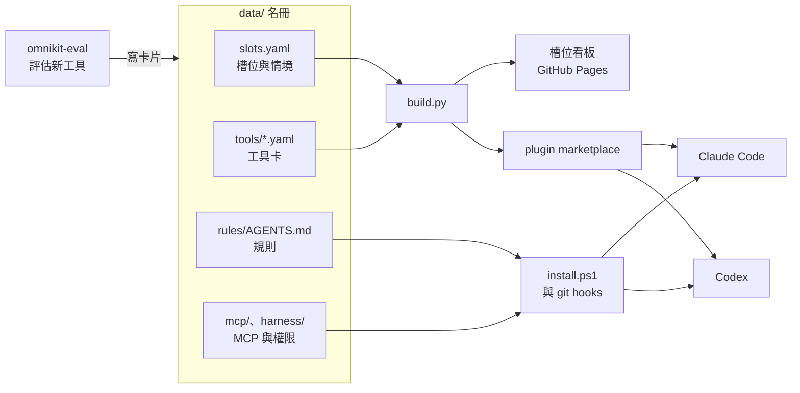

<div align="center">

# OmniKit

**讓你的 agent 設定自己汰舊換新，每個決定都有理由。**

[](https://github.com/b40609/OmniKit/actions/workflows/validate.yml)
[](https://b40609.github.io/OmniKit/)
[](LICENSE)
[](#常見問題)

[槽位看板](https://b40609.github.io/OmniKit/) · [快速開始](#快速開始) · [運作方式](#運作方式) · [常見問題](#常見問題)

</div>

<picture>
  <source media="(prefers-color-scheme: dark)" srcset=".github/assets/board-dark.png">
  
</picture>

Claude Code 與 Codex 的 plugin、skill、MCP 每週都有新的，裝了一堆之後，很難說清楚哪個真的有用、當初為什麼選它。

OmniKit 把「該用哪個」變成一份有紀錄的名冊。每一種需求是一個**槽位**，配上幾個真實的工作情境；每個工具一張**卡片**，記下狀態、日期與理由。新工具進來時，拿槽位的情境跟現任比，比贏了才換，換的理由也會留下來。

## 特色

- **每個決定都有理由**：卡片記下狀態（預設、試用、待評估、拒絕、退役）、決定日期與理由，過了半年還查得到當初為什麼選它。
- **用真實情境比，不看星數**：每個槽位配幾個你實際會遇到的情境，評估新工具就拿這些當考題。
- **一份設定，兩個 agent**：規則、skills、MCP、權限只寫一次，同步到 Claude Code 與 Codex。
- **名冊是唯一來源**：看板與兩份 plugin marketplace 都由名冊產生，CI 會檢查它們跟名冊一致。
- **評估分層、有額度**：第 0 層免費、第 1 層便宜、第 2 層實測；每週的實測次數有上限，不會一直燒 token。
- **安全的預設**：工具固定版本並比對 SHA256、commit 前用 gitleaks 掃金鑰、安裝第三方 skill 前先掃描、權限規則只增不刪。

## 快速開始

Fork 一份，換成你自己的規則與情境。fork 會帶著原作者已經整理好的 100 多張工具卡，可以直接當起點。

**需要：** Windows 11、[Git](https://git-scm.com/download/win)、[Node.js LTS](https://nodejs.org/)（MCP 用）、Claude Code 或 Codex、GitHub 帳號。

1. **Fork 並開啟看板。** 按本頁右上角的 **Fork**，接著在你的 fork 上：
   - **Actions** 分頁：fork 的 workflow 預設是關的，按 **I understand my workflows, go ahead and enable them**。
   - **Settings → Pages**：**Source** 選 **GitHub Actions**。

2. **Clone 到自己的電腦。**

   ```powershell
   git clone https://github.com/<你的帳號>/OmniKit.git
   cd OmniKit
   ```

3. **改成你的規則與情境。** `data/rules/AGENTS.md` 是 agent 會遵守的規則，`data/slots.yaml` 是槽位與情境；現在寫的是原作者的。不改的話會原封不動套到你的 agent 上，之後再改也行，git hook 會自動同步。

4. **安裝。** 可以重複執行。安裝前建議先看[安裝會改動哪些地方](#安裝會改動哪些地方)。

   ```powershell
   powershell -NoProfile -ExecutionPolicy Bypass -File engine\scripts\install.ps1
   ```

   偵測到這是 fork 時，會自動把 `data/omnikit.yaml` 的 `repo`、`owner`、`marketplace` 改成你的，並重新產生 marketplace 清單，避免跟原作者的撞名。

5. **推上去。** 推到 main 之後，GitHub Actions 會部署看板到 `https://<你的帳號>.github.io/OmniKit/`。

   ```powershell
   git commit -am "chore: 改成自己的 OmniKit"
   git push
   ```

6. **確認接上了。** 開一個新的 Claude Code 或 Codex session，問「OmniKit 規則版本是多少？」，回答跟 `data/rules/AGENTS.md` 開頭的版本一樣，就表示規則已經生效。

### 只想裝預設的 plugin

不用 fork，也不會動到你的其他設定。先把 OmniKit 加成 marketplace：

| | 指令 |
|---|---|
| Claude Code | `/plugin marketplace add b40609/OmniKit` |
| Codex | `codex plugin marketplace add b40609/OmniKit` |

再裝想要的 plugin，例如 frontend-design：

| | 指令 |
|---|---|
| Claude Code | `/plugin install frontend-design@omnikit-b40609` |
| Codex | `codex plugin add frontend-design@omnikit-b40609` |

目前收錄哪些，看[槽位看板](https://b40609.github.io/OmniKit/)的「安裝預設的 plugin」。

## 運作方式



1. **評估**：把工具的 GitHub 連結貼給 agent，`omnikit-eval` 會查 GitHub 現況、對照槽位情境，寫成一張工具卡。
2. **產生**：commit 時 git hook 驗證名冊並重新產生 marketplace 清單；推到 main 之後，GitHub Actions 重建看板。
3. **同步**：`install.ps1` 把規則、skills、MCP、權限接到 Claude Code 與 Codex；之後 commit 或 pull 動到這些檔案時，git hook 會自動再同步。

## 安裝會改動哪些地方

| 位置 | 做什麼 |
|---|---|
| `%LOCALAPPDATA%\Programs\` | 安裝固定版本的 skillshare、uv、gh、gitleaks；比對 SHA256，不改 PATH。這台已經有 uv、gh 就沿用 |
| `data/omnikit.yaml` | fork 出來的 repo，改成你的 `repo`、`owner`、`marketplace`，並重新產生 marketplace 清單 |
| `~/.claude/CLAUDE.md` | 在開頭加一段受管區塊，import `data/rules/AGENTS.md`；其他內容不動 |
| `~/.codex/AGENTS.md` | 換成 `data/rules/AGENTS.md` 的副本；第一次接上時，原本的內容先備份成 `AGENTS.md.pre-omnikit` |
| `~/.claude/skills`、`~/.agents/skills` | 由 skillshare 同步 `engine/skills` 裡的 skills |
| `~/.claude.json`、`~/.codex/config.toml` | 合併寫入 `data/mcp/servers.yaml` 的 MCP server，不動其他設定 |
| npm 全域套件 | 安裝 `data/mcp/packages.txt` 指定的固定版本 |
| `~/.claude/settings.json` | 把 `data/harness/claude-allow.txt` 的規則補進 `permissions.allow`，只增不刪 |
| 這個 repo | `core.hooksPath` 指到 `.githooks`：commit 前掃金鑰、驗證名冊；commit 或 pull 動到規則、MCP、權限時自動同步 |

加上 `-Fresh` 會把 `~/.claude/CLAUDE.md` 受管區塊以外的舊規則移除（先備份成 `CLAUDE.md.pre-omnikit`），適合想讓 OmniKit 的規則完全取代舊規則的人。

## 日常使用

### 評估新工具

在 Claude Code 或 Codex 裡直接說：

```text
幫我評估 https://github.com/<owner>/<repo>
這個跟現在用的比一下
每週彙整
```

| 層 | 成本 | 做什麼 |
|---|---|---|
| 0 | 免費 | GitHub 現況、名冊比對、硬性門檻、安全掃描 |
| 1 | 便宜 | 讀 README，對照槽位情境寫卡片，狀態是「待評估」 |
| 2 | 實測 | 拿槽位情境實際跑一遍並評分，點名才跑；紀錄放在 `data/evals/` |

### 改名冊

改完 `data/` 直接 commit：pre-commit hook 會驗證名冊，並重新產生 marketplace 清單一起放進 commit。要手動檢查：

```powershell
uv run engine/scripts/validate.py
uv run engine/scripts/build.py --site _site
```

uv 不在 PATH 上的話，把 `uv` 換成 `& "$env:LOCALAPPDATA\Programs\uv\uv.exe"`。CI 會再檢查名冊、marketplace 清單是不是最新、看板能不能產生，並用 gitleaks 掃金鑰。

### 跟上原作者的更新

在你的 fork 頁面按 **Sync fork**，或在本機：

```powershell
git remote add upstream https://github.com/b40609/OmniKit.git   # 只要做一次
git pull upstream main
```

- `data/` 有衝突時，留你自己的版本。
- 兩份 marketplace 清單有衝突時，直接重新產生：`uv run engine/scripts/build.py --marketplace-only`。
- `engine/` 有更新時，重跑一次 `install.ps1`。

## 目錄結構

```text
data/                        資料：fork 後換成你的
  omnikit.yaml               看板與 marketplace 的公開設定
  slots.yaml                 槽位與情境
  tools/<id>.yaml            名冊，一個工具一張卡
  rules/AGENTS.md            Claude Code 與 Codex 共用的規則
  mcp/                       MCP server 定義與 npm 套件版本
  harness/                   Claude Code 免問的權限規則
  evals/                     實測紀錄
engine/                      引擎：不用改
  schema/                    名冊與槽位的 JSON Schema
  scripts/                   安裝、驗證、產生看板與 marketplace
  site/                      看板的樣式與程式
  skills/omnikit-eval/       評估新工具的 skill
.claude-plugin/              Claude Code 的 marketplace（由名冊產生，不要手改）
.agents/plugins/             Codex 的 marketplace（由名冊產生，不要手改）
```

## 常見問題

<details>
<summary><b>會不會蓋掉我原本的設定？</b></summary>

不會直接蓋掉。`~/.claude/CLAUDE.md` 只加一段受管區塊；`~/.codex/AGENTS.md` 第一次接上時會先備份；MCP 與權限都是合併寫入。只有加上 `-Fresh` 才會移除 CLAUDE.md 的其他內容，而且也會先備份。完整清單見[安裝會改動哪些地方](#安裝會改動哪些地方)。

</details>

<details>
<summary><b>支援 macOS 或 Linux 嗎？</b></summary>

`install.ps1` 與 git hooks 目前只支援 Windows（PowerShell 5.1 或 7）。[只裝預設的 plugin](#只想裝預設的-plugin) 不受作業系統限制。

</details>

<details>
<summary><b>不想用某個預設工具怎麼辦？</b></summary>

把那張卡（`data/tools/<id>.yaml`）的 `status` 改掉並 commit，marketplace 與看板會跟著更新。已經裝好的 plugin 要自己移除。

</details>

<details>
<summary><b>安裝跑到一半出錯怎麼辦？</b></summary>

`install.ps1` 可以重複執行，修好原因後再跑一次就好。找不到 npm 時會略過 MCP 套件並提示，裝好 Node.js LTS 再重跑。

</details>

## 回報問題

安裝或使用遇到問題，請開 [Issue](https://github.com/b40609/OmniKit/issues)。

## 致謝

OmniKit 建立在這些專案上：[skillshare](https://github.com/runkids/skillshare)（同步規則、skills 與 MCP）、[uv](https://github.com/astral-sh/uv)（執行 Python 腳本）、[gitleaks](https://github.com/gitleaks/gitleaks)（掃描金鑰）、[GitHub CLI](https://github.com/cli/cli)。

## 授權

[MIT](LICENSE)
