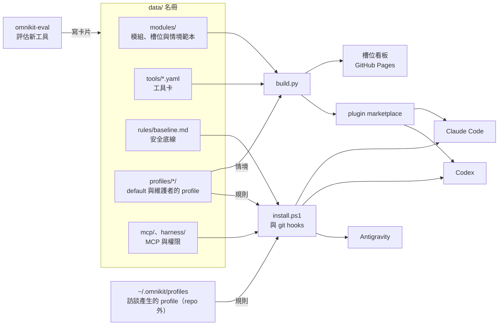
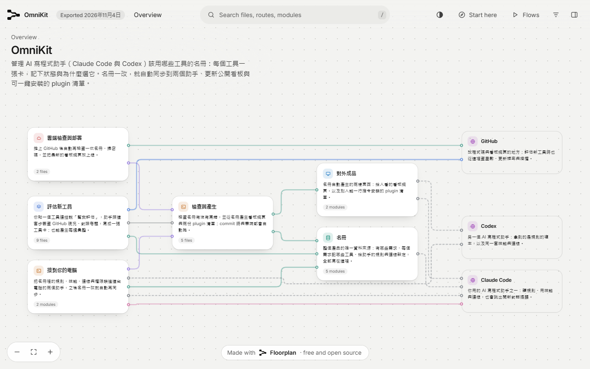

# 運作方式

[← 回到首頁](../README.md) · [安裝說明](install.md) · [使用指南](usage.md) · [子任務分派](dispatch.md) · [維護名冊](maintainer.md)

- [設計原則](#設計原則)
- [資料怎麼流](#資料怎麼流)
- [無帳本對帳與檢查](#無帳本對帳與檢查)
- [互動架構地圖](#互動架構地圖)
- [目錄結構](#目錄結構)

## 設計原則

- **每個決定都有理由**：工具卡記下狀態（預設、試用、待評估、拒絕、退役）、決定日期與理由，過了半年還查得到當初為什麼選它。
- **用真實情境比，不看星數**：每個槽位配幾個你實際會遇到的情境，評估新工具就拿這些當考題。
- **一份設定，三個 agent**：規則、skills、MCP 只寫一次，接到 Claude Code、Codex 與 Antigravity；全由 OmniKit 自己的腳本接，不依賴第三方同步工具。
- **名冊是唯一來源**：看板與兩份 plugin marketplace 都由名冊產生，CI 會檢查它們跟名冊一致。
- **評估分層、有額度**：第 0 層免費、第 1 層便宜、第 2 層實測；每週的實測次數有上限，不會一直燒 token。
- **安全的預設**：工具固定版本並比對 SHA256、commit 前用 gitleaks 掃金鑰、安裝第三方 skill 前先掃描、權限規則只增不刪。
- **常駐規則有預算**：常駐規則與自動觸發 skill 描述的位元組上限寫在 `data/rules/budget.yaml`，超過就擋 CI；補償模型弱點的規則登記在 `data/rules/patches.yaml`，附退役檢驗條件，新一代模型不需要就拿掉。

槽位照**模組**分成三層：基礎（agent 自己怎麼運作，例如記憶、權限）、能力（agent 碰得到什麼，例如瀏覽器、Office 檔、桌面程式）、領域（一種業務要交付的成果，例如軟體開發、數據分析、計畫書、CAD、影片、金融工程）。要加一種新的業務，新增一個模組檔就好，見[新增一種業務](maintainer.md#新增一種業務)。

## 資料怎麼流



1. **評估**：把工具的 GitHub 連結貼給 agent，`omnikit-eval` 會查 GitHub 現況、對照槽位情境，寫成一張工具卡。
2. **產生**：commit 時 git hook 驗證名冊並重新產生 marketplace 清單；需要更新線上看板時於 GitHub Actions 手動觸發「部署看板」。
3. **同步**：`install.ps1` 透過無帳本同步器（`engine/scripts/sync.py`）把規則（安全底線 + 你選的 profile）、skills、hooks 與 MCP 接到 Claude Code、Codex 與 Antigravity。開發模式（`-Dev`）下 commit 或 pull 動到這些檔案時，git hook 會自動再同步；標準安裝不設 git hook，pull 不會改任何設定。

## 無帳本對帳與檢查

OmniKit 採用無狀態對帳（不維護 `agents.json` 或 `.omnikit.json` 雜湊帳本），所有期望狀態皆由 repo 內的 manifest（`data/rules/`、`engine/skills/`、`data/mcp/servers.yaml`、`data/harness/claude-allow*.txt`）直接計算：

- **Claude Code 與 Antigravity 的 MCP／hooks**：包裝在獨立薄 plugin 目錄（`omnikit@omnikit-local` 與 `config/plugins/omnikit/`），不與你自己在頂層 `.claude.json` 或 `mcp_config.json` 設定的其他 server 混寫衝突。
- **Codex 的 MCP**：透過 `codex mcp` CLI 對帳設定，不會抹掉其他自訂 server。

想在不修改任何檔案的前提下檢查本機設定與端到端護欄健康狀態：

```powershell
uv run engine/scripts/sync.py sync --check   # 純唯讀對帳，有差異回傳 exit 1
uv run engine/scripts/doctor.py              # 全面健康檢查（含三方言 hook 端到端自測與 T3 實例檢查）
```

## 互動架構地圖

想看每個部分、每個檔案在做什麼，打開[互動架構地圖](https://b40609.github.io/OmniKit/map.html)：每個檔案都有白話說明，另有 3 條逐步導覽（評估新工具、改規則、第一次安裝）。建議用電腦開。`map.html` 是早期架構快照，最新的無帳本同步架構與檔案清單以[安裝會改動哪些地方](install.md#安裝會改動哪些地方)與下面的目錄結構為準。

<a href="https://b40609.github.io/OmniKit/map.html">
<picture>
  <source media="(prefers-color-scheme: dark)" srcset="../.github/assets/map-dark.png">
  
</picture>
</a>

## 目錄結構

```text
data/                        資料：fork 後換成你的
  omnikit.yaml               看板與 marketplace 的公開設定
  modules/<層>/<id>.yaml     模組：一個檔裡有幾個槽位與情境範本。層有三種：
                             foundation（基礎）、capability（能力）、domain（領域）
  tools/<id>.yaml            名冊，一個工具一張卡
  rules/baseline.md          安全底線，所有人都套用
  rules/dispatch.md          子任務分派的原則（常駐載入，幾行）
  rules/dispatch-policy.md   子任務分派的完整政策（級別、模型、思考程度、升級、委派紀錄；要派才讀）
  rules/budget.yaml          常駐規則與自動觸發 skill 描述的 bytes 預算棘輪上限
  rules/patches.yaml         常駐規則中屬於「模型能力補丁」的旁註與退役檢驗條件
  rules/mobile-web.md        行動端底線轉址說明（內容已移入 omnikit-mobile-web 按需 skill）
  tips.json                  對話開頭的用法小提示（新的官方功能加在這裡）
  profiles/<名稱>/           跟著 repo 的 profile：個人規則（AGENTS.md）、真實情境（scenarios.yaml）、分派用的實例（dispatch.md，可省略）；
                             default 是沒選時的預設。訪談產生的存在 repo 外（~/.omnikit/profiles）
  mcp/                       MCP server 定義與 npm 套件版本
  harness/                   Claude Code 免問的現行與墓碑權限規則
  evals/                     實測紀錄
docs/                        說明文件（安裝、使用、分派、運作方式、維護名冊）與參考資料
  cli-features.md            三家 CLI 內建功能與指令對照表
  starter.md                 新電腦起步清單
engine/                      引擎：不用改
  cockpit/                   本機控制面板後端與前端（按需啟動；只接受本機與這台 Tailscale 名稱的 Host，經 Tailscale 只能看，寫入與對帳要在本機開並帶啟動時產生的 token）
  schema/                    名冊與槽位的 JSON Schema
  scripts/                   安裝與移除（install.ps1／uninstall.ps1）、無帳本同步與健康檢查（sync.py／doctor.py）、profile 與帳號池、子任務分派、能力清點、名冊驗證與看板建置、護欄與提醒 hook
  site/                      看板的樣式與程式、匯出的架構地圖（map.html），以及 README 門面圖的產生器（readme_art.py）
  skills/ok/                 唯一簡短總入口選單（/ok、$ok，支援編號或白話對應）
  skills/omnikit-setup/      訪談建立個人 profile 的 skill
  skills/omnikit-eval/       評估新工具的 skill
  skills/omnikit-handoff/    交接與接手的 skill
  skills/omnikit-dispatch/   子任務分派與委派紀錄的 skill
  skills/omnikit-research/   飽和式調研（查同類工具、比較方案）的 skill
  skills/omnikit-capabilities/ 說做不到之前的能力清點（指令、MCP、本機端點）的 skill
  skills/omnikit-mobile-web/ 行動端（iOS Safari／WebKit）與桌面 WebApp 工程底線按需 skill
scripts/                     頂層工具入口（含本機 Cockpit 多專案面板 scripts/cockpit.py）
.claude-plugin/              Claude Code 的 marketplace（由名冊產生，不要手改）
.agents/plugins/             Codex 的 marketplace（由名冊產生，不要手改）
.github/assets/              README 的門面圖（hero、session 為 readme_art.py 產生的向量圖）與截圖
```
