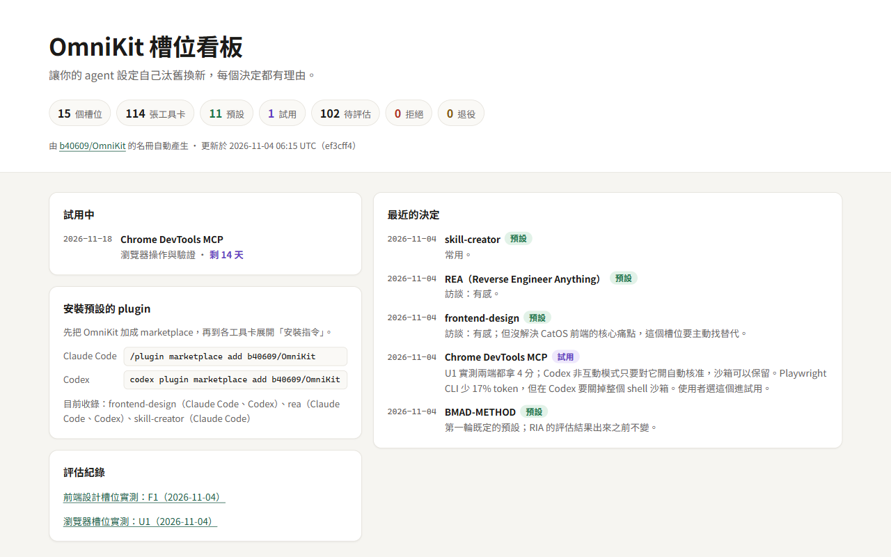

# 維護名冊

[← 回到首頁](../README.md) · [安裝說明](install.md) · [使用指南](usage.md) · [子任務分派](dispatch.md) · [運作方式](architecture.md)

給 fork 一份自己維護、或要改名冊的人。只用 OmniKit 的同事不需要讀這份。

- [槽位看板與新模型提醒](#槽位看板與新模型提醒)
- [新增一種業務](#新增一種業務)
- [槽位的答案](#槽位的答案)
- [改名冊](#改名冊)
- [發版與合併流程（分支保護＋PR＋tag）](#發版與合併流程分支保護prtag)
- [更新 README 門面圖](#更新-readme-門面圖)
- [更新架構地圖](#更新架構地圖)
- [跟上原作者的更新](#跟上原作者的更新)
- [本機 Cockpit 多專案面板](#本機-cockpit-多專案面板個人進階功能)

## 槽位看板與新模型提醒

- **線上槽位看板**：[b40609.github.io/OmniKit](https://b40609.github.io/OmniKit/) 列出試用中的工具、預設 plugin 的安裝指令與最近的決定。看板不自動部署，要更新時到 Actions 手動觸發「部署看板」（`.github/workflows/pages.yml`，`workflow_dispatch`）。

  <picture>
    <source media="(prefers-color-scheme: dark)" srcset="../.github/assets/board-dark.png">
    
  </picture>

- **每週新模型差異提醒**（規劃中，只提建議、不會靜默換模型）：看板首頁的「新模型」區塊列出每週偵測到的新模型、淘汰與建議對應；專案狀態板 `NOW.md` 的待決事項整理異動清單與建議角色順位，維護者拍板後才寫入政策；T3 排程任務在發現新模型或舊模型消失時開新對話通知。

## 新增一種業務

槽位寫在模組檔裡，一個模組一個檔：`data/modules/<層>/<id>.yaml`。

| 層 | 放什麼 | 例子 |
|---|---|---|
| `foundation` 基礎 | agent 自己怎麼運作，做什麼工作都會遇到 | 對話與記憶、輸出與品質 |
| `capability` 能力 | agent 要碰得到某種東西才做得了事；不只一個領域會用到才獨立出來 | 瀏覽器、文件與簡報檔、桌面程式 |
| `domain` 領域 | 一種業務要交付的成果 | 軟體開發、計畫書與專案管理、CAD 與機構設計 |

要加一種新的業務：

1. 複製一個現成的領域模組（例如 `data/modules/domain/video.yaml`）成新檔，檔名就是模組的 `id`。
2. 改名稱與一句說明，再列出槽位。一個槽位是一件要交付的工作，用動作加成果命名（「撰寫計畫書」「粗剪」），不是工具的類別；一個模組 3 到 6 個槽位。
3. 每個槽位至少寫一個情境，寫成可以實測的任務；`search` 填找工具用的關鍵字。
4. 需要瀏覽器、Office 檔這類能力，在 `requires` 列出能力模組的 `id`。
5. 跑 `uv run engine/scripts/validate.py` 檢查，再 commit。

規則：模組、槽位、情境的 `id` 在整份名冊裡都不能重複；情境 `id` 是 1 到 3 個大寫字母加數字（`PR1`、`CD4`）。任職單位或個人專屬的內容（補助單位的範本、公司內的規定）不要寫進模組檔，寫在自己 profile 的 `scenarios.yaml`。

## 槽位的答案

同一件工作在不同 agent 上的答案可以不一樣，寫在槽位的 `answers`，Claude Code 與 Codex 分開：

```yaml
answers:
  claude:
    verdict: native        # 內建的就夠
    reason: 實測的結論，一句話
    evidence: data/evals/<實測紀錄>.md
    decided_at: '2026-11-11'
  codex:
    verdict: tool          # 建議裝 tool 指的那張卡
    tool: chrome-devtools-mcp
    reason: 為什麼內建的不夠
    decided_at: '2026-11-11'
```

| `verdict` | 意思 | 要填什麼 |
|---|---|---|
| `native` | 內建的就夠 | `reason`、`decided_at` |
| `tool` | 建議裝某張卡 | `tool`、`reason`、`decided_at`；那張卡要放在這個槽位，而且支援這個 agent |
| `none` | 找過了，沒有好選擇 | `reason`、`decided_at` |
| `unknown` | 還沒實測 | 可以先在 `reason` 寫這個 agent 內建的功能是什麼 |

沒列的 agent 就是還不知道；看板與評估紀錄會據此標明各槽位應該用內建功能還是外裝工具。目前有實測的只有瀏覽器。

## 改名冊

改完 `data/` 直接 commit：開發模式（`-Dev`）的 pre-commit hook 會驗證名冊，並重新產生 marketplace 清單一起放進 commit。要手動檢查：

```powershell
uv run engine/scripts/validate.py
uv run engine/scripts/build.py --site _site
```

uv 不在 PATH 上的話，把 `uv` 換成 `& "$env:LOCALAPPDATA\Programs\uv\uv.exe"`。CI 會再檢查名冊、marketplace 清單是不是最新、看板能不能產生，並用 gitleaks 掃金鑰。

## 發版與合併流程（分支保護＋PR＋tag）

`main` 已啟用 GitHub 分支保護，所有改動一律走 PR 經過 CI 門檻才合併，不直接推 `main`：

1. **開分支與提交**：從最新 `main` 切出工作分支（例如 `fix/...`、`feat/...`），小步 commit 並推送該分支（不要用 `git push --mirror`；維護者本機掃全歷史請用 `--log-opts="--branches --remotes"`）。
2. **開 PR 等 CI 綠燈**：用 `gh pr create`（或 T3 的 `pull_request_create`）開 PR，等待「檢查」workflow 的必過檢查（`名冊`、`Windows（PowerShell 5.1）`、`Windows（PowerShell 7）`、`金鑰外洩`）全部通過。
3. **直接合併**：CI 全綠後直接合併（`gh pr merge` 或 `pull_request_merge`）並清理已合併分支；合併回 `main` 後由 `now_tick.py` 查證 `gh run list --commit <sha>` 全綠才在狀態板 `NOW.md` 打勾。
4. **發布穩定版本（tag）**：確認可發布的 `main` commit 後，建立並推送語意版本 tag（例如 `git tag -a v0.2.1 -m "發行說明"; git push origin v0.2.1`）。一般使用者端執行 `git fetch --tags --force; git checkout v0.2.1` 與 `install.ps1 -Tag v0.2.1` 即可升級，平日 `main` 上的變動不會波及已安裝的穩定版環境。

## 更新 README 門面圖

`.github/assets/hero-*.svg` 與 `session-*.svg` 由 `engine/site/readme_art.py` 產生，文字都轉成向量路徑，在任何系統上字形都一樣。改了文案、選單或護欄訊息時重跑：

```powershell
uv run engine/site/readme_art.py --fonts <字體資料夾>
```

字體是 SIL OFL 的 Geist、Geist Mono 與 Noto Sans TC，下載網址寫在 `readme_art.py` 檔頭，不進 repo。終端機預覽的字串要跟 `engine/skills/ok/SKILL.md` 的主選單、`engine/scripts/harness_hooks.py` 的攔截訊息一致（攔截訊息只取每則的前半句）。

貼連結到 LINE、Slack 時顯示的社群預覽圖是 `.github/assets/social-preview.png`（1280×640，`hero-light.svg` 置中放在同色底上的截圖）。GitHub 沒有上傳預覽圖的 API，但不用自己動手：agent 在已登入 GitHub 的桌面 Chrome 開 repo 的 **Settings → General**，用 Windows UI Automation 展開 Social preview 的 **Edit → Upload an image…**，檔案對話框用視窗訊息填路徑、按開啟（不動滑鼠鍵盤），選好就會直接存檔。換完用 `gh api graphql -f query='{repository(owner:"b40609",name:"OmniKit"){usesCustomOpenGraphImage openGraphImageUrl}}'` 確認，再把 `openGraphImageUrl` 下載下來跟檔案比對。

## 更新架構地圖

`engine/site/map.html` 是用 [Floorplan](https://github.com/haydenschmitty/floorplan) 在本機產生後匯出的，CI 不會重畫。`engine/` 有結構上的改動時，在裝了 Floorplan 的 Claude Code 裡說「更新 floorplan」，再匯出並 commit：

```powershell
node floorplan/serve.mjs --export engine/site/map.html
```

`floorplan/` 本身不進 git；換電腦後第一次要重畫整張地圖。

## 跟上原作者的更新

在你的 fork 頁面按 **Sync fork**，或在本機：

```powershell
git remote add upstream https://github.com/b40609/OmniKit.git   # 只要做一次
git pull upstream main
```

- `data/` 有衝突時，留你自己的版本。
- 兩份 marketplace 清單有衝突時，直接重新產生：`uv run engine/scripts/build.py --marketplace-only`。
- `engine/` 有更新時，重跑一次 `install.ps1`。

## 本機控制面板（Cockpit）CLI 與登入自啟

同時開多個專案與狀態板（`NOW.md`）時，控制面板預設隨安裝按需啟動（不常駐吃資源）；需要時也可透過 CLI 查看快照或啟用 Windows 登入背景自啟：

```powershell
uv run scripts/cockpit.py snapshot            # 終端機檢視所有已註冊專案現況
uv run scripts/cockpit.py serve --open        # 啟動本機網頁面板（預設 127.0.0.1:3780）
uv run scripts/cockpit.py register --name <專案> --path <目錄>
uv run scripts/cockpit.py autostart --status  # 查詢／管理 Windows 登入自啟（--install / --uninstall）
uv run scripts/cockpit.py watchdog-tick --json  # 看門狗跑一次：面板或背景巡檢失聯就重啟（每小時最多 3 次）
```

### 運行態三軸與探針（活著嗎｜版本對嗎｜資料新嗎）

`NOW.md` 只說「做到哪」；面板另外主動去看每個服務的三件事，三軸分開顯示、不混成一顆燈：

| 軸 | 看什麼 | 燈號 |
| --- | --- | --- |
| 活著嗎 | 行程或連接埠在不在 | 實心綠＝有新鮮產出佐證；空心綠＝只證實活著；紅＝沒在跑 |
| 版本對嗎 | 行程啟動時間對最後一次非文件 commit、回報版本對 HEAD、建置輸出對原始碼 | 琥珀＝版本漂移（改碼後沒重啟或沒重建） |
| 資料新嗎 | 產出檔、SQLite 最新一筆或心跳有沒有在期限內更新 | 紅＝資料沒更新 |

不用改專案的程式碼。在面板的專案詳情按「加探針」（只在這台電腦本機開啟時看得到，存進 `~/.omnikit/cockpit/config.json`），或在專案根目錄放一份跟著 Git 走的 `omnikit.probes.yaml` 給團隊共用（同 `id` 的服務以個人設定為準）：

```yaml
services:
  - name: 報價 API
    probes:
      - {type: tcp, port: 8000}
      - {type: http, url: "http://127.0.0.1:8000/health", version_json_path: commit}
      - {type: artifact, glob: "out/*.csv", max_age_s: 3600}
  - name: 每日報表
    active_days: [mon, tue, wed, thu, fri]
    probes:
      - {type: win_task, name: "\\MyTasks\\Daily Report"}
      - {type: artifact, sqlite_path: data/app.db, table: reports, ts_col: created_at, max_age_days: 1}
```

探針類型有 `tcp`、`http`、`process`、`win_task`、`artifact`（產出檔或唯讀 SQLite）、`heartbeat`（`engine/schema/heartbeat.schema.json` 規格的心跳檔，可用 `override_period_s` 以讀取方的期望為準）。安全邊界寫死不能放寬：`tcp` 與 `http` 只連本機（127.0.0.1、localhost），SQLite 一律唯讀且表名、欄位名過白名單，專案共用設定只能用專案內的相對路徑，經 Tailscale 開啟時不能改任何探針設定。

`serve` 啟動後背景巡檢每 60 秒掃一輪（`OMNIKIT_COCKPIT_POLL_S` 或設定的 `runtime.poll_interval_s` 可調），結果寫進 `~/.omnikit/cockpit/snapshot.json`，自己的心跳寫在 `poller-heartbeat.json`。`autostart --install` 會一併登記使用者層級、不需系統管理員的工作排程「OmniKit Cockpit Watchdog」（每 10 分鐘跑一次 `watchdog-tick`，不要就加 `--no-watchdog`）；`autostart --uninstall` 與 `uninstall.ps1` 會把它移掉。面板連續 2 輪連不上，或快照超過 5 分鐘沒更新時，頁面頂部會亮「控制平面失聯或快照過期」，這時畫面上的燈號不代表現況。
