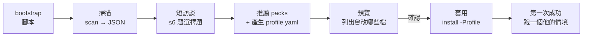

# 同事安裝 OmniKit 之後：個人化上手方案（提案）

日期：2026-11-04　狀態：階段 1、2、3 已實作；階段 4 待決定

- 階段 3：支援範圍定為 Windows 11 + Claude Code、Codex、Antigravity（不再等同事回報環境）。公司電腦的
  Trend Micro 會擋 skillshare，允許的通知要剛好盯著畫面才按得到，背景同步常失敗；範圍固定三個 agent 之後，
  skillshare 的多 agent 支援用不到，所以改由 `engine/scripts/agents.py` 自己接規則、skills 與 MCP，拿掉 skillshare。
  Antigravity 的位置是在這台實測確認的：規則 `~/.gemini/GEMINI.md`、skills `~/.gemini/config/skills` 與
  `~/.agents/skills`（不跟隨資料夾連結，所以用複製）、MCP `~/.gemini/config/mcp_config.json`（讀到 BOM 會整份失敗）。

- 階段 1：規則分成安全底線與 profile，情境改成範本。
- 階段 2：`scan.py` 掃描、`omnikit-setup` 訪談、`profile_new.py` 依答案產生 profile、`install.ps1 -WhatIf` 預覽。跟原計畫的差別：掃描改用 Python（能在 CI 測、skill 直接讀 JSON），不擴充 `inventory.ps1`；profile 直接產生 `data/profiles/<名稱>/` 的 `AGENTS.md` 與 `scenarios.yaml`，不另外做 `profile.yaml`；工具包（packs）還沒做，訪談先調整規則與情境。

下面「現況」引用的行號是階段 1 之前的版本，那時規則還在 `data/rules/AGENTS.md`。

## 0. 需要你決定的事

| # | 決定 | 建議 |
|---|---|---|
| 1 | OmniKit 的定位：維持「你的個人配置」，還是變成「可發給同事的配置發行版」 | 變成發行版，但用分層讓你的配置變成其中一個 profile（`ryan`），你自己照樣用 |
| 2 | 個人化做法：A 直接套你的設置／B 裝完自由跟 agent 討論／C 工具包 + 掃描 + 訪談 | C 的改良版：腳本掃描 + 最多 6 題選擇題訪談 + 推薦工具包 + 預覽後才套用 + 跑一次真實情境 |
| 3 | 同事的個人 profile 放哪 | 預設放本機（不需要 GitHub、fork、Pages）；想同步或跨電腦再推到自己的 fork |
| 4 | 先支援哪些 agent | 需要你提供：同事用的 agent、作業系統、安裝時的錯誤訊息原文 |

## 1. 現況：現在是「安裝即套用你的設置」

證據：

- `README.md:51`：「不改的話會原封不動套到你的 agent 上」。個人化的唯一途徑是 fork 後自己改檔，沒有引導。
- `data/rules/AGENTS.md:21-22`：「下載、安裝直接執行，不要先問我確認」「只有刪除類操作才需要先確認」。這是**你的授權偏好**，同事沒同意過，卻會套到他的 agent 上。這是最需要先處理的問題。
- `data/rules/AGENTS.md:28`：git 身分規則描述的是你的電腦。
- `data/slots.yaml`：8 處提到 CatOS／OmniKeep。評估工具的考題全是你的專案，同事拿來評估沒有意義。
- `engine/scripts/install.ps1:211`、`:218`：skillshare target 寫死 `claude,codex`。同事用別的 agent，skills 與規則都不會到位。
- `README.md:38`：前置需求 Windows 11、Git、Node.js、Claude Code 或 Codex、GitHub 帳號，外加 fork、開 Actions、開 Pages。門檻偏高。
- `install.ps1` 一次改 9 個地方（README「安裝會改動哪些地方」），全有或全無。

根本原因：OmniKit 現在綁了兩個產品。

1. **工具治理引擎**：名冊、槽位、評估、看板。適合「工具裝太多、會持續評估新工具」的人，也就是你。
2. **你的精選配置**：規則、skills、MCP、權限、提醒 hook。

同事需要的是「適合自己的配置，裝完馬上好用」，治理引擎對新手是額外負擔。他不知道能幫到什麼，是因為裝到的東西都是為你的工作設計的。

## 2. 你提的三個選項

| | A. 安裝即套用你的設置（現況） | B. 裝完跟 agent 自由討論 | C. 工具包 + 掃描 + grill-me |
|---|---|---|---|
| 同事上手成本 | 低（但裝完不知道有什麼用） | 高，每人要花時間聊 | 中 |
| 配置合不合身 | 差，是你的需求 | 好 | 好 |
| 結果穩定、可重現 | 高 | 低：模型不同（訂閱不同）產出就不同，難更新 | 中到高（看有沒有 schema 收斂） |
| 安全底線 | 套了你的寬鬆授權 | 沒保證 | 可以保證（底線層固定） |
| 你的維護成本 | 低 | 低，但出問題難支援 | 中：要維護工具包 |
| 跨 agent | 只有 Claude Code、Codex | 靠 agent 自己摸索 | 要做 adapter |

C 方向對，但有三個坑：

- **grill-me 問太多**：它設計來一路追問到底，適合規劃大功能，不適合 onboarding。新手被問 20 題會放棄。
- **讓 LLM 直接寫設定檔**：同事的模型可能比較弱，直接改 `~/.codex/config.toml` 之類的檔案容易壞。
- **雞生蛋**：訪談要在 agent 裡跑，但 OmniKit 還沒裝好，agent 怎麼知道要訪談？

## 3. 業界怎麼做

| 做法 | 代表 | 可以借的 |
|---|---|---|
| 第一次執行時問少數問題，答案存起來給範本用，只問一次 | chezmoi 的 `promptStringOnce` | 訪談答案存成 profile，範本產生設定；重跑不會再問 |
| 角色範本：選一個起點再自己改 | VS Code Profile Templates（Python、Java、Data Science 等） | 工具包（pack）按角色分 |
| init 時先選 agent，再產生該 agent 的檔案 | GitHub Spec Kit `specify init --ai claude/gemini/copilot/cursor-agent` | adapter 依 agent 寫到不同位置 |
| 規則寫一次，產生各 agent 的原生檔 | Ruler、rulesync（rulesync 列出 20 種以上工具） | 規則的單一來源 + 輸出到各 agent |
| skills 同步到多種 agent | skillshare（文件說支援 60 種以上 CLI，`init` 會自動偵測已安裝的） | **你已經在用**，只是 `install.ps1` 寫死兩個 target |
| 跨 agent 規則標準 | AGENTS.md：Codex、Cursor 原生讀；Copilot 2025-08 起支援；Gemini CLI 設 `context.fileName` 就讀；Claude Code 用 `@AGENTS.md` import | 規則用 AGENTS.md 當唯一格式 |
| skills 跨 agent 標準 | Agent Skills（SKILL.md），Anthropic 2025-12 開放，多家支援但實作深度不一 | skills 不用為每家重寫 |
| 角色導向的引導安裝 | Anthropic 的 setup-claude skill：依角色裝 plugin、接工具、試一個 skill | 最後一步要「試一次」，讓人看到效果 |
| 掃描專案產生規則檔 | Claude Code `/init`（有報導說新版改成訪談式，未找到官方文件證實） | 掃描先做，問題只問掃不到的 |

## 4. 建議方案：三層 + 掃描 + 短訪談 + 預覽套用 + 第一次成功

### 4.1 拆成三層

```text
baseline/        所有人都套用，不能關：安全紅線
                 （刪除前確認、不讀不印金鑰、不對外發送、push 要明確指示）
packs/           工具包，按用途分，每包 = 規則片段 + skills + MCP + 槽位情境範本
  general/       通用開發（預設必裝）
  frontend/      前端
  python-data/   Python 與資料分析
  docs/          文件與簡報
  research/      研究調查
  governance/    工具治理：名冊、評估、看板（OmniKit 原本的核心，進階選裝）
profiles/<人>/   個人層：語言、語氣、授權程度、自己的情境
  ryan/          你現在的 data/rules、slots 搬進來
```

重點：

- 你的寬鬆授權（下載直接裝）移到 `profiles/ryan`，不再是預設。
- 「授權程度」變成訪談題目，同事自己選。
- `slots.yaml` 的情境改成範本，訪談時用同事的專案名稱填。

### 4.2 流程



1. **bootstrap（腳本）**：只裝最小的東西：偵測有哪些 agent，把 `omnikit-setup` skill 同步過去，印出「開新 session，說：幫我設定 OmniKit」。agent 不支援 skills 時，退回 `SETUP.md`，讓同事貼給 agent。
2. **掃描（腳本，不花 token）**：擴充現有的 `engine/scripts/inventory.ps1`（已經是唯讀盤點、不碰金鑰），改成輸出 JSON：作業系統、裝了哪些 agent 與版本、既有的規則／skills／MCP、Node／Git／uv 有沒有、常用語言（看最近的 repo）。
3. **短訪談（agent，最多 6 題，選擇題為主）**：掃得到的不問，只做確認。
   1. 主要用 agent 做什麼？（多選：寫程式／資料分析／文件簡報／研究調查）→ 決定 packs
   2. 主要語言與框架？（掃描結果預填，確認即可）
   3. 最想改善哪 1–2 件事？（回覆太長／常改太多／換對話就忘／權限提示太多／改完沒驗證）→ 對應槽位
   4. 回覆語言與詳略？
   5. agent 可以自己做到哪？（每步都問／安裝直接做、刪除才問／大多放手）→ 規則的「確認」段與權限
   6. 要不要持續評估新工具？（否就不裝 governance pack）

   想更準的人可以說「再問深一點」，這時才進 grill-me 式追問。
4. **產生 profile（agent 填、腳本驗證）**：agent 只填 `profile.yaml`，用 JSON Schema 驗證（沿用 `validate.py` 的做法）。LLM 負責判斷，寫入設定檔交給腳本，弱一點的模型也不會把設定改壞。
5. **預覽（腳本）**：`install.ps1 -Profile <name> -WhatIf`，列出會改哪些檔、加哪些權限，確認後才動。
6. **套用（腳本）**：只裝選中的 packs，只寫到偵測到的 agent。skillshare 改成自動偵測 target，不再寫死 `claude,codex`。
7. **第一次成功**：用訪談第 3 題的痛點，挑一個對應的 skill 實際跑一次，最後印出「你的 OmniKit 卡」：裝了什麼、什麼時候會觸發、怎麼關掉。

### 4.3 設計原則

- **LLM 判斷，腳本寫入**：訪談與推薦交給 agent，改設定檔一律走腳本與 schema。
- **先預覽再套用，全部可逆**：沿用現有的 install-record 與 uninstall.ps1。
- **底線不給選**：安全紅線在 baseline，profile 只能更嚴、不能更寬。
- **你也走同一條路**：你的配置就是 `profiles/ryan`，每次改機制都會先在你身上測到。

## 5. 分階段落地

| 階段 | 內容 | 大小 |
|---|---|---|
| 0（現在就能做） | 問同事 agent、作業系統、錯誤原文；請他跑 `inventory.ps1` 把結果給你；裝壞了先用 `uninstall.ps1` 還原；短期只給他「只裝預設 plugin」那條路（不限作業系統） | 小，不改程式 |
| 1 | 拆層：`data/rules/AGENTS.md` 拆成 baseline 與 `profiles/ryan`；寬鬆授權移出預設；`slots.yaml` 情境改範本 | 中 |
| 2 | `scan`（JSON）+ `omnikit-setup` skill（6 題訪談 → `profile.yaml`）+ `install.ps1 -Profile` 與 `-WhatIf` | 中到大 |
| 3 | adapter：skillshare 自動偵測 target；規則依 agent 寫到各自的全域位置；做不到的（例如只能在 UI 設的全域規則）就印出來請同事貼 | 中，看同事用什麼 agent |
| 4 | 回饋：每週彙整加上「哪些 skill 30 天沒觸發過」，建議移除 | 小 |

## 6. 風險

- **packs 維護成本**：一開始只做 `general` 與一個同事真的需要的 pack，不要一次做 6 個。
- **全域規則位置各家不同**：有些 agent 的全域規則只能在設定畫面填，adapter 要能退回「印出來請你貼上」。
- **Agent Skills 各家實作深度不一**：skill 寫法維持在規格的共同子集，不依賴單一 agent 的功能。
- **macOS／Linux**：`install.ps1` 只支援 Windows。同事若不是 Windows，階段 2 的 scan 與 install 要改成 Python（uv 跑），PowerShell 只留薄殼。

## 參考來源

- [Ruler（intellectronica）](https://developertoolkit.ai/en/ecosystem/frameworks/rules-sync/)
- [rulesync（dyoshikawa）](https://dev.to/dyoshikawatech/rulesync-published-a-tool-to-unify-management-of-rules-for-claude-code-gemini-cli-and-cursor-390f)
- [Spec Kit：支援的 agent](https://github.github.com/spec-kit/reference/integrations.html)
- [chezmoi：setup 與 promptStringOnce](https://chezmoi.io/user-guide/setup)
- [skillshare：supported targets](https://skillshare.runkids.cc/docs/targets)
- [Agent Skills 支援的 agent](https://www.mdskills.ai/learn/ai-agents-that-support-skill-md-2026)
- [AGENTS.md、CLAUDE.md、GEMINI.md 比較](https://inventivehq.com/blog/claude-md-vs-agents-md-vs-gemini-md)
- [VS Code 1.78 profile templates](https://www.infoworld.com/article/3695770/visual-studio-code-178-debuts-profile-templates-for-python-java-angular.html)
- [Claude Code 訪談式 /init 報導（未經官方證實）](https://gentic.news/article/claude-code-introduces-interactive-init-command-to-automate-project-configuratio)
