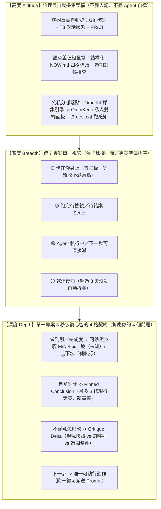
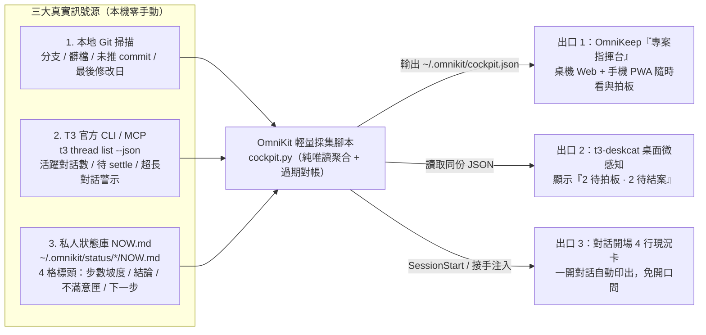

# 跨專案進度追蹤、上下文恢復與指揮中心：業界飽和調研與三維度架構提案

日期：2026-11-24（2026-11-25 收尾更新）  
狀態：【已上線運作 v2（本機 `:3780` 登入自啟 ＋ Tailscale `:2389` 手機 PWA ＋ T3 可見佇列自動對帳）】  
依據規範：`omnikit-research` 飽和式調研（12 組關鍵字、94 個不重複候選、33 個代表性專案 `gh api` 實測；★1,000 以上 GitHub repo 連續 3 組無新名字，達「長尾未飽和」停止條件）

---

## 0. 已定案的最終決策（2026-11-24 拍板）

> 討論收斂更正：原先提案草稿將面板落點建議在 OmniKeep；經對齊定位後，OmniKit 本質為「共用預設底層＋每個人本機微調疊層」的個人工作台，因此**不接入 OmniKeep，也不再另外養兩套 UI**，集中火力維護 **1 套「OmniKit 個人面板（本機＋Tailscale 手機 PWA）」**。

| # | 定案項目 | 最終方案 | 關鍵依據 |
|---|---|---|---|
| **D1** | **面板落點與雙層架構** | **單一 OmniKit 個人面板（本機私有服務＋Tailscale 手機 PWA）**，上下兩層自動疊加：<br>① 共用預設底層（repo 工具名冊、模型規則、架構地圖）<br>② 個人私有疊層（`~/.omnikit/` profile、多帳號額度、跨專案指揮台） | 產品邊界最純粹（不混入 OmniKeep）；同事裝 OmniKit 也能在本機開屬於自己的私有面板；資料永遠不進公開 repo。 |
| **D2** | **v1 互動範圍（精準版 A）** | 全景球權分流 ＋ 三源過期紅燈（Git＋`t3 thread list --json`＋`NOW.md`）＋ 手機／桌機即時新增與勾銷「不滿意待改」＋ 一鍵複製下一步／對帳指令與跳轉 T3 ＋ 整合「工具與模型（個人疊層）／帳號額度／架構地圖」 | 2026-11-24 實測 `t3 thread --help` 僅支援 `list/start/send/show`（無 `settle` 子指令），且遵守「先有使用再蓋引擎」：v1 先跑順 4 格欄位與日常使用，v2（12-01 解凍後）再視需要加背景模型自動刷新 `NOW.md` 與 `t3-deskcat` 微感知。 |
| **D3** | **多機專案支援** | 專案清單取「本機註冊專案 ∪ `~/.omnikit/status/*`」聯集；同步時對狀態庫做唯讀 `git pull --ff-only` | 同時涵蓋桌機、筆電與公司電腦專案：本機有目錄跑完整三源對帳，只在狀態庫有的標記為「遠端專案」照樣顯示 4 格卡。 |
| **D4** | **動工時機與邊界** | **現在先做獨立 v1 原型（`engine/cockpit/`＋`scripts/cockpit.py`）**，零改動既有 hook、規則檔、marketplace 與既有腳本；僅擴充 `omnikit-handoff` 的 `NOW.md` 四格範本 | 立即解決眼前 7 個專案、23 條未結案對話與千項超載主線痛點，同時嚴守 11-29 凍結期不破壞核心系統的精神。 |
| **D5** | **既有公開 GitHub Pages** | **凍結自動部署、保留 `build.py` 腳本不動**（`marketplace.json` 仍靠它產生）；未來若要對外展示再從個人面板匯出去敏靜態版 | 避免養兩套 UI 的維護債，也不破壞既有 CI。調整 `pages.yml` 與設定本機 `tailscale serve` 埠前另行確認。 |

---

## 1. 真實現況診斷：為什麼有了 `NOW.md` 還是每次忘記？

盤點這台電腦目前的真實工作負載（由 T3 MCP `t3_project_list` 與 `t3_thread_list` 實測讀取）：

1. **7 個專案同步推進，橫跨電腦與手機**：
   - 目前 T3 註冊了 `OmniKit`、`OmniKeep`、`CatOS`、`UAnalyze`、`t3-deskcat`、`LinePort`、`<工作專案>` 共 7 個正式專案。
   - 未結案（unsettled）對話高達 **23 條**，其中多條主線已成超長巨獸：
     - `CatOS` 主線（`模擬盤 Bot 後續工作`）：**1,965 items / 111 輪**（從 11-17 跑到 11-24）
     - `UAnalyze` 主線：**1,923 items / 36 輪**（由手機端啟動）
     - `OmniKeep` 主線：**1,416 items / 31 輪**（由手機端啟動）
     - `t3-deskcat`（`T3 服務中斷排查與修復`）：**953 items / 21 輪**，另有 1 條已完成未 settle
     - `LinePort`：v1.1.0 與 v1.2.0 兩條（439 與 388 items）皆已 `completed` 卻未 `settle`，還掛著 6 條 idle 子代理對話。
2. **現有兩套工具的結構性缺口**：
   - **OmniKit 線上看板（[engine/scripts/build.py](../../engine/scripts/build.py)）**：是公開的 GitHub Pages，用來管「139 張工具卡名冊」，既不能放私人專案敏感進度，也看不到本機正在跑的對話與未 commit 程式碼。
   - **私人狀態板 `NOW.md`（[2026-11-21-convergence.md](2026-11-21-convergence.md)）**：雖然解決了跨裝置隱私存放，但有四個致命斷層：
     1. **分散在 7 個資料夾**：沒有跨專案單一畫面（Single Pane of Glass），切專案前不會主動去翻 7 個 Markdown 檔。
     2. **無對帳機制，極易過期**：對話跑到 1,900 項還沒收尾時，`NOW.md` 停在好幾天前，沒有程式告訴你「這份 `NOW.md` 已經落後 Git 12 個 commit」。
     3. **缺乏「結論結晶」**：過程流水帳與最終拍板結論混在一起，切回來還要問「所以我們上次結論是什麼？」。
     4. **缺乏「不滿意差距卡」**：當你對 UI 或分析結果不滿意時，沒有結構化記錄「哪裡不滿意、試過什麼、改成怎樣算過」，回來只能重問「我不滿意還要怎麼改？」。

---

## 2. 深度 × 廣度 × 高度：三維度拆解業界頂尖方法與工具



### 維度一：【深度 Depth】解決「切回單一專案時腦袋空白」——認知科學與 4 問對 4 欄

為什麼切回專案時，就算有對話紀錄還是要重問 4 個問題？
- **軟體工程實證（Chris Parnin & Spencer Rugaber，《Resumption Strategies for Interrupted Programming Tasks》與《Evaluating Cues for Resuming Interrupted Programming Tasks》）**：
  - 實測數千次開發中斷後發現，**只有 10% 的工作階段能在 1 分鐘內恢復工作**，93% 必須四處翻找檔案與舊紀錄來重建心智狀態（Resumption Lag）。
  - 實驗證明：提供**自動化的活動與差異線索（Automated Context-Recovery Cues）**，任務恢復成功率是純靠手動筆記的 **2 倍**；且工程師最容易吸收的是「時間序的精簡關鍵變更與錨點」，而非長篇摘要。
- **轉場微日誌（Interstitial Journaling，Tony Stubblebine）與外部化工作記憶（Externalized Working Memory）**：
  - 獨立開發者同時推多個專案時，大腦只能當 CPU 不能當硬碟。離開專案的那 15 秒必須刷空快取（Flush Mental Cache），只留結構化指標。

將你每次必問的 **4 個問題**，直接一對一映射為每個專案固定的 **4 格狀態契約**：

| 你每次問的問題 | 傳統做法為什麼失敗 | 業界頂尖做法（結構化欄位） |
|---|---|---|
| **1.「做到哪？目前完成度多少？」** | 憑印象報 `70%`，結果最後 `10%` 卡兩週（「永遠 90% 症候群」） | **【通過步數 `M/N` ＋ Shape Up 坡度】**<br>借鏡 Basecamp《Shape Up》Hill Chart 與 Linear Milestones：不報主觀百分比，只寫 **`[3/5 步已驗證通過]`** 搭配 **`⛰️ 上坡（還在探索做法／有未知風險）`** 或 **`🛷 下坡（做法已定，只剩寫完跑測試）`**。 |
| **2.「目前結論？」** | 埋在第 800 則對話裡，翻不到，Agent 壓縮後自己也失憶 | **【現行定案匣 Pinned Conclusion】**<br>借鏡 ADR（架構決策紀錄）微縮版：只保留**最新生效的 1 到 3 條結論**（例如：`採方案 C：引擎放 OmniKit、UI 放 OmniKeep（11-24 定案）`），舊討論封存進連結，新決定直接覆蓋舊決定。 |
| **3.「我不滿意還要怎麼改？」** | 主觀感覺留在腦中（「畫面怪怪的」「回測不夠穩」），切走再回來連嫌哪裡都忘記 | **【驗收差距匣 Critique & Acceptance Delta】**<br>借鏡業界 **Closed-Loop Critique Workflow** 與你自己的 [`omnikit-ask`](../../engine/skills/omnikit-ask/SKILL.md)：只要你說「不滿意」，Agent 必須先把它寫成三行差距卡：<br>① **現況**：現在長怎樣（附截圖或數據路徑）<br>② **痛點**：你嫌哪裡（例如：首屏資訊太擠、沒有一鍵複製）<br>③ **過關標準**：改成什麼可驗證條件才算修好（最多迭代 2-3 輪收斂）。 |
| **4.「下一步？」** | 列了 8 個待辦，每次回來還要重新排優先順序、想怎麼開口 | **【唯一球權下一步 Single Next Action】**<br>借鏡 GTD 與 Beads `bd ready`：永遠只放 **1 個沒有被擋住的最優先動作**，明確標註 **`[🔴 等你拍板]`** 或 **`[🟢 Agent 可直接跑]`**，並附上一句可直接送出的起始 Prompt。 |

---

### 維度二：【廣度 Breadth】橫看業界 5 大工具流派——誰解決了什麼、誰漏了什麼？

本次飽和調研橫掃 12 組關鍵字、94 個候選專案（完整實測星數見第 5 節），整個 2025–2026 生態系可收斂為 **5 大流派**（第三方功能描述未在本機實裝測試者標註「待驗證」）：

| 流派 | 代表性專案（2026-11-24 `gh api` 實測星數） | 核心強項（解決哪個維度） | 為什麼單靠它解決不了你的問題 |
|---|---|---|---|
| **1. 多 Agent 桌面開發環境（ADE / Worktree GUI）** | - `stablyai/orca`（★134,873, MIT）<br>- `pingdotgg/t3code`（★75,668, MIT）<br>- `herdrdev/herdr`（★52,538, Apache-2.0）<br>- `manaflow-ai/cmux`（★28,932）<br>- `slopus/happy`（★24,779, MIT）<br>- `ParadevAI/Paradev`（原 Superset，★16,532, MIT）<br>- `OrchestratorInc/agent-orchestrator`（★15,066, Apache-2.0）<br>- `generalaction/emdash`（★6,296, Apache-2.0）<br>- `Dimillian/CodexMonitor`（★4,374, MIT） | **工作區隔離與執行態監控**：把多個專案、worktree 與 CLI/ACP 對話收進單一側邊欄，即時看哪條對話在跑、哪條在等權限、支援手機端回覆（Orca/Happy/T3，部分細節待驗證）。 | **管「對話（Thread）」，不管「專案心智（Project State）」**。<br>你已經用 T3 Code 當主力了！但 T3 只知道「這條對話跑完了」，不知道「這個專案整體做到第幾步、結論是什麼、哪裡你還不滿意」。換另一套 ADE 只是換個聊天殼。 |
| **2. AI 看板與組織級控制面（Kanban / Control Plane）** | - `paperclipai/paperclip`（★116,469, MIT）<br>- `multica-ai/multica`（★57,609）<br>- `BloopAI/vibe-kanban`（★28,798, Apache-2.0）<br>- `builderz-labs/mission-control`（★6,518, MIT）<br>- `cline/kanban`（★1,393, Apache-2.0）<br>- **GitHub Copilot Mission Control**（官方功能，待驗證） | **球權視覺化與中途轉向（Mid-run Steering）**：以任務卡為中心（Backlog -> Running -> Needs You -> Review -> Done），誰卡在人類拍板一目了然；Copilot Mission Control 支援中途暫停修正方向。 | **重型雙頭馬車風險**。<br>Paperclip / Multica 偏向把 Agent 當虛擬公司管理（含組織圖、預算、獨立 DB，待驗證）；若在 T3 之外另養一套重型任務伺服器，你得在兩邊同步開卡與開對話，三天就會放棄。**但它們的「Needs You 球權置頂」設計極值得直接借鏡！** |
| **3. 隨 Git 走的結構化任務帳本（Git Task Graph）** | - `gastownhall/beads`（★28,974, MIT）<br>- `gastownhall/gastown`（★18,873, MIT）<br>- `automazeio/ccpm`（★8,465, MIT，11-21 查證） | **結構化相依性**：任務與阻擋關係寫成機器可讀結構，`bd ready` 直接算出下一步，不靠對話記憶（待驗證）。 | 單一 repo 內好用，但**沒有跨 7 個專案的全局戰情室視圖**，且 Beads 新版依賴 Dolt，對輕量專案過重。 |
| **4. 多 Repo 客觀狀態雷達與開發者入口（Multi-Repo & IDP）** | - `backstage/backstage`（★34,909, Apache-2.0）<br>- `dlvhdr/gh-dash`（★12,767, MIT）<br>- `agent-of-empires/agent-of-empires`（★4,777, MIT）<br>- `nosarthur/gita`（★1,968, MIT）<br>- `asheshgoplani/agent-deck`（★1,297, MIT） | **100% 客觀事實零維護**：`gita` 一行列出所有本地 repo 的分支、髒檔（dirty）、未推 commit；`gh-dash` 聚合跨 repo 的 PR 與 CI；`Backstage` 用各 repo 的小型描述檔聚合成全局目錄與健康計分卡。 | 純 Git/CI 工具只看得到程式碼有沒有 push、CI 有沒有過，看不到「商業／產品結論」與「你滿不滿意」。 |
| **5. 周邊視覺與微感知（Ambient HUD / Menu Bar）** | - `humanlayer/humanlayer`（★12,939, Apache-2.0）<br>- `Ark0N/Codeman`（★848, MIT）<br>- `AgentManager` / `Skipper`（待驗證）<br>- 你正在做的 **`t3-deskcat`** | **零點擊被動感知**：不用主動去開某個 Dashboard 分頁，狀態直接浮在螢幕角落、瀏覽器分頁燈號或桌面小寵物上，有事才找你。 | 只能當「提醒入口」，點開後背後仍需要一份乾淨的跨專案狀態資料源。 |

#### 廣度維度的關鍵洞見：Linear 的組合管理（Portfolio Hygiene）三原則
頂尖工程團隊在 **Linear（Initiatives -> Projects -> Project Updates）** 管理多專案時，有三個鐵律正好打中你的痛點：
1. **嚴格限制同時 Active 的專案數，不做的標 `Parked`**：7 個專案不可能同一天都在大改。面板預設只展開「近 72 小時有動靜或卡在你身上」的專案，其餘自動歸入「停泊區（Parked）」。
2. **健康燈號三態化（On Track / Refining / Blocked on Me）**：一眼看出哪個專案順著跑、哪個因為你不滿意正在來回修（Refining）、哪個在等你拍板（Blocked on Me）。
3. **進度由底層里程碑自動捲動（Roll-up），嚴禁手拉百分比**。

---

### 維度三：【高度 Altitude】架構治理——為什麼不該直接塞進公開 OmniKit 看板，而該做「三層聯動」？

如果你直接在公開的 OmniKit 槽位看板（`b40609.github.io/OmniKit/`）加一頁「我的所有專案 Dashboard」，一週內就會遇到三個死結：
1. **機密外洩風險**：`<工作專案>`（公司的查核點）與 `CatOS`（交易策略結論）不能進公開 GitHub repo。
2. **動靜態脫鉤**：雲端靜態網頁讀不到本機 `C:\dev\CatOS` 還有沒有沒 commit 的髒檔，也讀不到本機 T3 裡那 23 條未結案對話。
3. **違反 OmniKit 11-17 收斂原則**：OmniKit 是跨電腦、同事也能裝的輕量規則與工作流包，不該綁死你個人的專案清單。

#### 真正頂尖的架構解法：「三源自動採集引擎（OmniKit）」×「私人雙端指揮台（OmniKeep）」×「周邊微感知（t3-deskcat ＋ 開場注入）」

你手上的生態系其實已經把拼圖湊齊了 90%，只差最後一條**「自動聚合管線」**把它們串起來：



這套架構在「高度」上有四個無可取代的優勢：

1. **零手動填表也能抓出 80% 真相（防失憶保底）**：
   - 就算某個專案的 Agent 忘記更新 `NOW.md`，`cockpit.py` 一跑 `t3_project_list` + `git status` + `t3 thread list --json`，照樣能精準告訴你：
     - 「`LinePort`：Git 乾淨，但有 **2 條已完成對話還沒 settle**（v1.1.0、v1.2.0）＋ 6 條殘留子代理」
     - 「`CatOS`：主線已達 **1,965 items（超載紅燈）**，最後活躍於 14:39，`NOW.md` 落後最新 commit **⚠️ 已過期**」
   - 光靠這層確定性對帳，你就再也不會被過期的筆記騙了！
2. **「不滿意」變成閉環資產，不再靠記憶硬撐**：
   - 當你在任何專案覺得「做出來不滿意，不知道怎麼改」時：
     1. 觸發 `omnikit-ask`（問法庫已有 UI/UX/架構等 73 個情境）幫你把模糊的不滿意問清楚，必要時開瀏覽器截圖對照。
     2. 把對照結果寫入該專案 `NOW.md` 的 `critique_delta` 區塊（現況、嫌哪裡、過關驗證條件）。
     3. 指揮台上該專案立刻掛上 `🎨 待收斂` 徽章；修完驗證通過才清空。
3. **桌機、手機、桌面餘光、對話內「四處同源」**：
   - 在座位上寫扣時：桌角 `t3-deskcat` 直接告訴你哪個專案剛跑完在等你；開新對話第一回合自動看到該專案 4 行現況卡。
   - 離開座位滑手機時：打開 `OmniKeep` 手機端（你今天早上才剛接好 `OmniKeep <-> OmniKit` 橋接！），一頁滑完 7 個專案的完成度、結論與待拍板事項，點一下就能複製下一步指令去 T3 手機版開跑！
4. **完全相容同事版**：
   - `cockpit.py` 放在 OmniKit 裡完全不含你的私人專案名稱（專案清單自動從這台電腦的 T3 註冊專案或 `~/.omnikit/status/` 探索）；同事裝 OmniKit 跑 `cockpit.py`，看到的就是同事自己的專案儀表板！

---

## 3. 跨專案指揮台（Cockpit）介面線框設計（unslop 純工具風）

遵循你個人規則的 `unslop` 高密度實用工具風（參考 `Models.dev` + `Linear` + `Vibe Kanban` 的球權分組，零行銷廢話）：

```text
+--------------------------------------------------------------------------------------------------+
| OmniKeep · 專案指揮台 (Cockpit)                    [同步對帳: 剛剛] [搜尋 /] [隱藏停泊專案 (2)] |
| 球權總覽: [🔴 等你拍板 / 驗收: 3]   [🟡 已跑完待 Settle: 2]   [🟢 Agent 執行中: 2]   [⚠️ 過期: 1] |
+--------------------------------------------------------------------------------------------------+
| 🔴 第一優先：卡在你身上（Blocked on Ryan）                                                       |
| +----------------------------------------------------------------------------------------------+ |
| | [OmniKit]  進度: 2/4 步 (🛷 下坡)  | 分支: main (dirty: 1) | 主線: 18 items                  | |
| | 📌 目前結論: 工具評估與 OmniKeep 手機閉環已打通 (070a1d5)；11-29 前維持凍結期只修錯與收斂。  | |
| | 🎨 不滿意待改: 跨 7 專案常忘記做到哪與結論 -> 待拍板採用「三源採集 + OmniKeep 指揮台」方案。 | |
| | 👉 下一步 [等你決定]: 拍板 D1–D3 決定後，先產出無副作用的 cockpit.py 快照原型驗證。          | |
| |    [打開 T3 對話]  [檢視 NOW.md]  [複製下一步指令]                                           | |
| +----------------------------------------------------------------------------------------------+ |
| | [t3-deskcat] 進度: 3/5 步 (⛰️ 上坡) | 分支: main | 活躍對話: 2 條 (1 條跑完未 settle, 953項) | |
| | 📌 目前結論: Weekly Progress Ring Widget 改版已完成初版，同步排查 T3 服務中斷問題。          | |
| | 🎨 不滿意待改: 進度環視覺層次待驗收 -> 需確認窄視窗下字級與狀態燈號對比度。                  | |
| | 👉 下一步 [等你驗收]: 檢視 Redesign Weekly Progress Ring Widget 結果，通過即 settle 子對話。 | |
| +----------------------------------------------------------------------------------------------+ |
+--------------------------------------------------------------------------------------------------+
| 🟡 已完成待收尾（Ready to Settle — 釋放側邊欄雜訊！）                                            |
| - [LinePort] v1.1.0 防無聲死亡 (439項) + v1.2.0 傳檔修復 (388項) + 6 條閒置子代理  [一鍵檢查收尾] |
| - [UAnalyze] 補上 GitHub 專案使用說明與試用步驟 (227項, completed)                [一鍵檢查收尾] |
+--------------------------------------------------------------------------------------------------+
| 🟢 執行中 / 隨時可推進（Active Lanes）                                                           |
| - [CatOS]    模擬盤 Bot 後續工作 | ⚠️ 主線 1,965 項超載！建議立刻交接換新主線 | 進度: 待對帳     |
| - [UAnalyze] UAnalyze 主線       | ⚠️ 主線 1,923 項超載！手機開啟執行中       | 進度: 待對帳     |
| - [OmniKeep] 手機收件匣藍色框與細節檢查 (301項, completed 待驗收) | 主線 1,416 項                |
+--------------------------------------------------------------------------------------------------+
| ⚪ 已停泊（Parked > 3 天無活動，點此展開: <工作專案> ...）                                   |
+--------------------------------------------------------------------------------------------------+
```

你看上面這張表——光是用我們剛剛從你本機撈出來的真實數據填進去，是不是**一秒鐘就把你手上 7 個專案的混亂全貌、哪裡超載、哪條忘了結案、哪個在等你拍板**照得一清二楚？！

---

## 4. 漸進式落地路線圖（嚴守「先有使用再蓋引擎」與 11-29 凍結期）

照 [2026-11-17-summary.md](2026-11-17-summary.md) 第 3 節原則（「先手動／最小驗證兩輪，確定天天看才蓋自動化 UI」），建議分三小步走，絕不一次過度工程：

1. **第 0 步（現在就能做，零風險、不改現有 hook）**：
   - 先整理眼前 T3 已經跑完卻掛著的對話（例如 `LinePort`、`UAnalyze` 子對話結案，`CatOS` 與 `UAnalyze` 破 1,900 項的主線執行一次乾淨交接），並把結構化 4 格標頭（`進度 M/N + 坡度`、`目前結論`、`不滿意差距匣`、`唯一球權下一步`）補進 `omnikit-handoff` 的 `NOW.md` 範本。
2. **第 1 步（本機單檔原型 `cockpit.py`，約 150–200 行純唯讀 Python）**：
   - 讀取 T3 專案清單（經 `t3` CLI，**絕不碰 `statev2.sqlite`**）、各專案 `git status / log -1`、以及 `~/.omnikit/status/<專案>/NOW.md`，輸出一份 `~/.omnikit/cockpit.json` 與本機單檔預覽 `~/.omnikit/cockpit.html`。
   - 你實際每天早上／切專案時打開用 3 到 5 天，驗證這 4 個欄位能不能讓你「不用再問做到哪、結論是什麼、不滿意怎麼改」。
3. **第 2 步（2026-11-25 已上線收尾，後續延伸列收件匣觀察）**：
   - **已上線完成（2026-11-25）**：主從式行動端 v2 介面（首屏精簡清單＋全屏詳情頁，通過 Playwright `webkit` 行動端巡檢）、`reconciler.py` 單執行緒 FIFO 背景自動對帳（透過可見 T3 對話寫回 `NOW.md` 並消紅燈）、以及 `scripts/cockpit.py autostart --install` Windows 登入無黑窗背景自啟（配合 Tailscale HTTPS `:2389` 長駐）。
   - **列收件匣觀察（12-01 解凍後視實際日常使用頻率再決定是否施作）**：
     - **多使用者分工適配完整版**（同事安裝後的自訂欄位與團隊面板視角）。
     - **桌面微感知串接**：讓 `t3-deskcat` 直接讀取 `~/.omnikit/cockpit/snapshot.json` 顯示「待拍板／待收尾／超載」計數。
     - **對話開場 4 行注入 ＋ 收尾過期提醒**：需動到既有 hook，維持先觀察不提前擴張。

---

## 5. 飽和式調研完整紀錄（依 `omnikit-research` 規範必附）

### 5.1 判斷標準與子題邊界
- **子題定義**：跨多專案／多 coding agent 工作階段的進度總覽、指揮中心（Mission Control）、工作區狀態看板與上下文恢復工具。
- **納入標準**：能同時監控、聚合或視覺化多個專案／多個 coding agent 工作階段的進度、待決狀態（Waiting/Blocked/Done）、Git 分支／Worktree 狀態，或協助跨專案恢復上下文的工具、面板與框架。
- **排除標準**：純單一對話聊天介面、無 Git/Agent 連動的通用企業 PM SaaS、純單一 repo 內的規格生成模板（已於 [2026-11-21-convergence.md](2026-11-21-convergence.md) 查過 75 個候選）、純 API 呼叫延遲計費代理。

### 5.2 檢索管道與受限說明
- **帳本位置**：`$env:TEMP\multiproject-mission-control-ledger.json`（位於系統暫存目錄，不進 repo）。
- **每組必查程式管道（8 個）**：`github-topic`、`github-keyword`、`awesome`、`skills-sh`、`npm`、`mcp-registry`、`hn`（Hacker News Algolia API）、`exa`（Exa hosted MCP 語意搜尋），外加每組至少一種網頁搜尋（`web-en` 或 `web-zh`）。
- **整次必查管道**：中文網頁搜尋（`web-zh`）、英文網頁搜尋（`web-en`）、Product Hunt（`site:producthunt.com`）、主要專案關聯與 README 競品抽取（`related`：已抽 `andyrewlee/awesome-agent-orchestrators`、`BloopAI/vibe-kanban`、`OrchestratorInc/agent-orchestrator`）。
- **查不到或受限的管道與原因**：
  - 第 3 組中文關鍵字「`多專案 進度 看板 開發`」不含 3 字元以上英文字，`sweep.py` 內建安全規則自動略過 `skills-sh` 與 `mcp-registry`（0 筆），改由 `exa` 與 `web-zh` 補足。
  - `Exa MCP` 為匿名呼叫，每組上限回傳前 10 筆語意結果，未發生 429 阻斷。
  - `skills.sh` 依規範每次查詢間隔 3 秒以上，12 組全數成功回應無 503。
  - `Product Hunt` 官方 GraphQL API 需專有 Token，依規範採用 `site:producthunt.com` 網頁搜尋替代。

### 5.3 12 組關鍵字擴展軌跡與 `sweep.py status --min-stars 1000` 實際輸出

關鍵字從起手 3 組（一般工程說法 `multi repo status dashboard`、精準同義 `claude code dashboard`、中文原意 `多專案 進度 看板 開發`），依結果出現的新詞（`vibe-kanban`、`worktree`、`parallel coding agents`、`internal developer portal`、`agent orchestrator`、`mission control`、`session manager`、`git dashboard tui`、`codexmonitor`）逐步擴展至第 12 組：

```text
總共 94 個不重複的名字；連續 0 組沒有新名字（要 3 組）：還不能停
★1000 以上的 GitHub repo：連續 3 組沒有新的（要 3 組）：可以停，報告寫「長尾未飽和」並附上面兩種連續數
第 1 組「multi repo status dashboard」：11 個名字，新的 11 個；管道：github-topic, github-keyword, awesome, skills-sh, npm, mcp-registry, hn, exa, web-en, producthunt
  ★1000 以上的新名字：dlvhdr/gh-dash, nosarthur/gita
第 2 組「claude code dashboard」：20 個名字，新的 20 個；管道：github-topic, github-keyword, awesome, skills-sh, npm, mcp-registry, hn, exa, web-en
  ★1000 以上的新名字：dietrichgebert/ponytail, stablyai/orca, paperclipai/paperclip, herdrdev/herdr, manaflow-ai/cmux, slopus/happy, paradevai/paradev, orchestratorinc/agent-orchestrator, hoangsonww/claude-code-agent-monitor, builderz-labs/mission-control
第 3 組「多專案 進度 看板 開發」：4 個名字，新的 4 個；管道：github-topic, github-keyword, awesome, skills-sh, npm, mcp-registry, hn, exa, web-zh
  ★1000 以上的新名字：nimbalyst/nimbalyst
第 4 組「vibe kanban worktree」：23 個名字，新的 23 個；管道：github-topic, github-keyword, awesome, skills-sh, npm, mcp-registry, hn, exa, web-en, related
  ★1000 以上的新名字：preset-io/agor, dohooo/helmor, sipyourdrink-ltd/bernstein, johannesjo/parallel-code, BloopAI/vibe-kanban, cline/kanban, smtg-ai/claude-squad, asheshgoplani/agent-deck, pingdotgg/t3code, generalaction/emdash, runmaestro/maestro, multica-ai/multica, agent-of-empires/agent-of-empires, kbwo/ccmanager, getpaseo/paseo, humanlayer/humanlayer, gastownhall/gastown, Dimillian/CodexMonitor
第 5 組「parallel coding agents」：12 個名字，新的 5 個；管道：github-topic, github-keyword, awesome, skills-sh, npm, mcp-registry, hn, exa, web-en
  ★1000 以上的新名字：automazeio/ccpm, open-mercato/cezar, yohey-w/multi-agent-shogun, standardagents/dmux
第 6 組「internal developer portal catalog」：6 個名字，新的 4 個；管道：github-topic, github-keyword, awesome, skills-sh, npm, mcp-registry, hn, exa, web-en
  ★1000 以上的新名字：backstage/backstage
第 7 組「agent orchestrator」：10 個名字，新的 2 個；管道：github-topic, github-keyword, awesome, skills-sh, npm, mcp-registry, hn, exa, web-en
  ★1000 以上的新名字：composiohq/agent-orchestrator
第 8 組「mission control coding」：8 個名字，新的 4 個；管道：github-topic, github-keyword, awesome, skills-sh, npm, mcp-registry, hn, exa, web-en
  ★1000 以上的新名字：crshdn/mission-control
第 9 組「agent session manager」：10 個名字，新的 5 個；管道：github-topic, github-keyword, awesome, skills-sh, npm, mcp-registry, hn, exa, web-en
  ★1000 以上的新名字：njbrake/agent-of-empires
第 10 組「git dashboard tui」：11 個名字，新的 4 個；管道：github-topic, github-keyword, awesome, skills-sh, npm, mcp-registry, hn, exa, web-en
  （無 ★1000 以上新名字）
第 11 組「worktree session dashboard」：8 個名字，新的 8 個；管道：github-topic, github-keyword, awesome, skills-sh, npm, mcp-registry, hn, exa, web-en
  （無 ★1000 以上新名字）
第 12 組「codex session monitor」：7 個名字，新的 4 個；管道：github-topic, github-keyword, awesome, skills-sh, npm, mcp-registry, hn, exa, web-en
  （無 ★1000 以上新名字）
```

- **停止判定**：**長尾未飽和**（第 12 組停；全部名字連續無新增組數 = `0`、★1,000 以上 GitHub repo 連續無新增組數 = `3`［第 10、11、12 組］）。★1,000 以下的小型個人專案與無 GitHub 星數的商業獨立網站不保證窮盡。

### 5.4 代表性專案 `sweep.py verify` 實測表（2026-11-24 `gh api` 查證）

| 專案 (`owner/repo`) | 實測星數 | 授權 | 封存 | 最後 Push | 分類定位 |
|---|---:|---|---|---|---|
| `DietrichGebert/ponytail` | ★197,656 | MIT | 否 | 2026-11-22 | 行為引導 Hook（OmniKit 名冊已收錄待評） |
| `stablyai/orca` | ★134,873 | MIT | 否 | 2026-11-24 | 跨平台多 Agent Worktree ADE + 手機推播（名冊已收錄） |
| `paperclipai/paperclip` | ★116,469 | MIT | 否 | 2026-11-24 | 虛擬公司級多 Agent 控制面（任務、審批、預算看板） |
| `pingdotgg/t3code` | ★75,668 | MIT | 否 | 2026-11-24 | 多供應商多專案 GUI（目前本機主力） |
| `multica-ai/multica` | ★57,609 | NOASSERTION | 否 | 2026-11-24 | 將 Coding Agent 當團隊成員派單與追蹤看板 |
| `herdrdev/herdr` | ★52,538 | Apache-2.0 | 否 | 2026-11-19 | 多終端狀態分組（Working/Blocked/Done，名冊已收錄） |
| `backstage/backstage` | ★34,909 | Apache-2.0 | 否 | 2026-11-24 | CNCF 內部開發者入口（跨 Repo 資產目錄與健康度計分卡鼻祖） |
| `gastownhall/beads` | ★28,974 | MIT | 否 | 2026-11-24 | 隨 Git 走的 Agent 任務相依帳本（`bd ready`） |
| `manaflow-ai/cmux` | ★28,932 | NOASSERTION | 否 | 2026-11-24 | Ghostty 基底的多工 Agent 終端（macOS 為主） |
| `BloopAI/vibe-kanban` | ★28,798 | Apache-2.0 | 否 | 2026-11-15 | Worktree + Kanban 平行編排開創者 |
| `slopus/happy` | ★24,779 | MIT | 否 | 2026-11-24 | 跨桌面與行動端的 Claude/Codex 遠端控制與監控 |
| `gastownhall/gastown` | ★18,873 | MIT | 否 | 2026-11-14 | 多 Agent 工作區編排（搭配 Beads） |
| `ParadevAI/Paradev` | ★16,532 | MIT | 否 | 2026-11-24 | 原 Superset，平行 Worktree + 預覽埠 + Diff 審查 |
| `OrchestratorInc/agent-orchestrator` | ★15,066 | Apache-2.0 | 否 | 2026-11-24 | 跨桌面與手機的平行 Agent 艦隊監控（從任務到 PR） |
| `humanlayer/humanlayer` | ★12,939 | Apache-2.0 | 否 | 2026-11-23 | 人機迴路（Human-in-the-Loop）審批與聯絡路由 |
| `dlvhdr/gh-dash` | ★12,767 | MIT | 否 | 2026-11-21 | 跨 Repo PR / Issue / CI 狀態高密度終端儀表板 |
| `smtg-ai/claude-squad` | ★8,860 | AGPL-3.0 | 否 | 2026-11-13 | Tmux + Worktree 多工 TUI 管理 |
| `builderz-labs/mission-control` | ★6,518 | MIT | 否 | 2026-11-23 | SQLite 本機自架多 Agent 任務與狀態控制面 |
| `generalaction/emdash` | ★6,296 | Apache-2.0 | 否 | 2026-11-23 | 跨平台桌面平行 Worktree Agent 執行器 |
| `agent-of-empires/agent-of-empires` | ★4,777 | MIT | 否 | 2026-11-24 | Tmux 多 Agent 狀態偵測與管理 |
| `Dimillian/CodexMonitor` | ★4,374 | MIT | 否 | 2026-03-26 | Tauri 跨專案工作區與 Codex 對話監控室 |
| `RunMaestro/Maestro` | ★3,623 | AGPL-3.0 | 否 | 2026-11-24 | 鍵盤優先的桌面多 Agent 指揮中心 |
| `crshdn/mission-control` | ★2,162 | MIT | 否 | 2026-09-16 | 任務控制面板 |
| `nimbalyst/nimbalyst` | ★2,103 | MIT | 否 | 2026-11-23 | 整合規格文件、看板與平行 Agent 工作區 |
| `nosarthur/gita` | ★1,968 | MIT | 否 | 2026-10-21 | 跨多本地 Git Repo 並排檢視分支、髒檔與未推狀態 |
| `preset-io/agor` | ★1,494 | NOASSERTION | 否 | 2026-11-24 | 多人／多 Agent 空間化畫布工作區 |
| `cline/kanban` | ★1,393 | Apache-2.0 | 否 | 2026-11-13 | 本地瀏覽器 Worktree 看板與行內審查迴圈 |
| `asheshgoplani/agent-deck` | ★1,297 | MIT | 否 | 2026-11-23 | Go TUI 多專案 Session 狀態追蹤器 |
| `kbwo/ccmanager` | ★1,280 | MIT | 否 | 2026-10-27 | 免 Tmux 的跨 Worktree 多 Agent 狀態選單 |
| `johannesjo/parallel-code` | ★1,105 | MIT | 否 | 2026-11-23 | 桌面並排多 Agent Worktree 與集中看板 |
| `Ark0N/Codeman` | ★848 | MIT | 否 | 2026-11-20 | 自架 Web/手機雙端多 Agent 指揮面板（燈號提示） |
| `simple10/agents-observe` | ★739 | MIT | 否 | 2026-09-04 | Hook 即時串流觀測 Claude Code 與 Codex 動作 |
| `imbue-ai/sculptor` | ★285 | MIT | 否 | 2026-11-23 | 隔離環境平行驗證工作區 |

---

## 6. 參考來源

1. Chris Parnin & Spencer Rugaber, *Resumption Strategies for Interrupted Programming Tasks* (ICPC / Software Quality Journal) & *Evaluating Cues for Resuming Interrupted Programming Tasks* (Microsoft Research / Georgia Tech).
2. Ryan Singer, *Shape Up: Stop Running in Circles and Ship Work that Matters* — Chapter 12 & 13 (Hill Charts: Figuring it out vs. Making it happen).
3. Linear, *The Linear Method — Initiatives, Projects, and Project Updates* (`https://linear.app/docs/initiatives`、`https://linear.app/method`).
4. Anthropic Engineering, *Effective harnesses for long-running agents* (`https://www.anthropic.com/engineering/effective-harnesses-for-long-running-agents`).
5. GitHub Blog, *How to orchestrate agents using mission control* (`https://github.blog/ai-and-ml/github-copilot/how-to-orchestrate-agents-using-mission-control/`).
6. Backstage CNCF, *Backstage Software Catalog* (`https://backstage.io/docs/features/software-catalog/`).
7. OmniKit 內部既有定案對照：[2026-11-17-summary.md](2026-11-17-summary.md)、[2026-11-19-dashboard-competitor-research.md](../../data/evals/2026-11-19-dashboard-competitor-research.md)、[2026-11-21-convergence.md](2026-11-21-convergence.md)、[2026-11-24-omnikeep-eval-bridge.md](../reports/2026-11-24-omnikeep-eval-bridge.md)。
